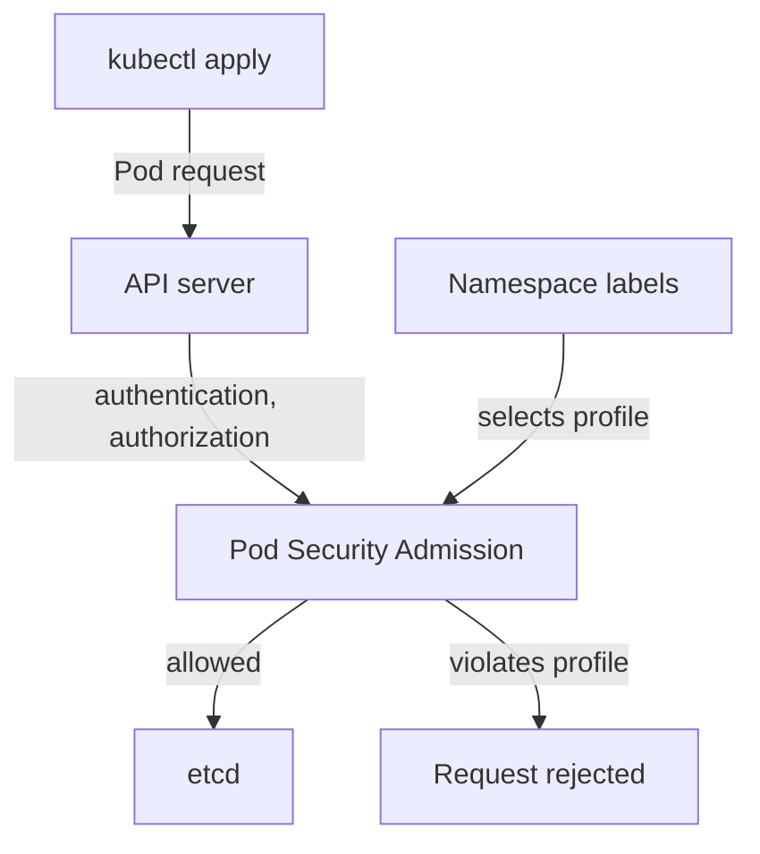

# The Three Pod Security Standards

A container is not a virtual machine. It is a process on the node, and the Pod spec decides how much of the node that process can reach. A privileged container, a container on the host network or a mounted host directory each give a process far more access than an ordinary application needs. If one of those Pods runs a vulnerable application, an attacker starts with that access. This part explains the three rule sets that Kubernetes uses to limit Pods, and tests each of them with requests you send yourself.

## Three profiles, one rule each

The **Pod Security Standards** are three profiles defined by Kubernetes. A **profile** is a fixed list of Pod settings that are allowed or forbidden. The profiles are cumulative: each one adds rules to the one before.

- **Privileged** has no restrictions. A Pod may use any setting. It is meant for system components that need node access, such as a CNI plugin or a storage driver.
- **Baseline** blocks the settings that are known to give a container access to the node. It still lets most existing applications run without change.
- **Restricted** follows current hardening practice. It adds rules that most ordinary applications can meet with a few lines of configuration, but older images that run as root fail it.

Baseline forbids these settings, among others:

- `privileged: true` on a container.
- `hostNetwork`, `hostPID` and `hostIPC` set to `true`.
- `hostPath` volumes and `hostPort` values.
- Linux capabilities beyond a short allowed list (for example `NET_BIND_SERVICE` and `CHOWN` are allowed, `SYS_ADMIN` and `NET_ADMIN` are not).
- A seccomp profile of type `Unconfined`, an AppArmor profile other than the runtime default, and most custom SELinux options.
- Sysctls outside the safe list, and a non-default `/proc` mount type.

Restricted keeps all of that and adds these rules:

- `allowPrivilegeEscalation` must be `false` in every container.
- The Pod must run as non-root: `runAsNonRoot: true`, and no `runAsUser: 0`.
- A seccomp profile must be set, with type `RuntimeDefault` or `Localhost`.
- Every container must drop `ALL` capabilities, and it may add back only `NET_BIND_SERVICE`.
- Volume types are limited to `configMap`, `csi`, `downwardAPI`, `emptyDir`, `ephemeral`, `persistentVolumeClaim`, `projected` and `secret`.

Notice what Restricted does not require: `readOnlyRootFilesystem` is a good hardening setting, but no profile demands it.

## What does the checking

**Pod Security Admission** is an admission controller built into the Kubernetes API server. An admission controller is code that runs inside the API server after a request is authenticated and authorized, and before the object is stored. It can accept the request, change it or reject it. Pod Security Admission only accepts or rejects. It has been enabled by default since Kubernetes 1.25, when it replaced PodSecurityPolicy, which was removed.

The administrator chooses the profile for each namespace with labels. The API server reads the labels on the namespace of the incoming Pod and compares the Pod with the profile.



The diagram shows that the namespace labels only select the profile, and that the API server, not the kubelet, rejects a Pod that violates it.

## Test the profiles with a privileged Pod

Start with a namespace that enforces Baseline. A server-side dry-run request goes through the full admission chain, including Pod Security Admission, but stores nothing. That makes it a safe way to test a policy.

<!-- astrona:playground:renew -->

Save this as `namespace-profiles-demo.yaml`:

```yaml
apiVersion: v1
kind: Namespace
metadata:
  name: profiles-demo
  labels:
    pod-security.kubernetes.io/enforce: baseline
```

Apply it:

```sh
kubectl apply -f namespace-profiles-demo.yaml
```

Then check the result:

```sh
kubectl get namespace profiles-demo --show-labels
```

The output shows the `pod-security.kubernetes.io/enforce=baseline` label. Now save a privileged Pod as `pod-privileged.yaml`:

```yaml
apiVersion: v1
kind: Pod
metadata:
  name: privileged-check
  namespace: profiles-demo
spec:
  containers:
  - name: check
    image: docker.io/library/busybox:1.37.0
    command: ["sleep", "3600"]
    securityContext:
      privileged: true
```

Send it as a server-side dry run:

```sh
kubectl apply -f pod-privileged.yaml --dry-run=server
```

The command fails with an error from the server. The message starts with `Error from server (Forbidden)` and says that the Pod is forbidden because it `violates PodSecurity "baseline:latest"`. It also names the exact setting: the container `check` must not set `securityContext.privileged=true`. The API server rejected the Pod, so the Pod never reached the scheduler or a node.

## Test the profiles with a plain Pod

Now try a Pod that sets nothing special. Save this as `pod-plain.yaml`:

```yaml
apiVersion: v1
kind: Pod
metadata:
  name: plain-check
  namespace: profiles-demo
spec:
  containers:
  - name: check
    image: docker.io/library/busybox:1.37.0
    command: ["sleep", "3600"]
```

Send it as a server-side dry run:

```sh
kubectl apply -f pod-plain.yaml --dry-run=server
```

This time the command reports that the Pod would be created (the line ends with `created (server dry run)`). Baseline accepts a Pod that runs as root with default capabilities, because those settings do not give direct access to the node. Raise the namespace to Restricted and send the same request again:

```sh
kubectl label namespace profiles-demo pod-security.kubernetes.io/enforce=restricted --overwrite
kubectl apply -f pod-plain.yaml --dry-run=server
```

The second command now fails. The message lists every Restricted rule the Pod breaks, in one line: `allowPrivilegeEscalation != false`, `unrestricted capabilities`, `runAsNonRoot != true` and `seccompProfile`. Each entry names the container, so you can fix all of them at once. The Pod spec did not change; only the profile on the namespace did.

You can now tell the profiles apart by what they reject: Baseline stops the privileged Pod and accepts the plain Pod, and Restricted stops both. The plain Pod shows the gap between the two. The next question is how to write a Pod that Restricted accepts, and which of its fields the application may need to adapt to.

## Common pitfalls

> [!WARNING]
> - **Expecting a namespace with no labels to be protected.** Without Pod Security labels, the cluster default applies, and the default is Privileged: nothing is checked.
> - **Testing with a client-side dry run.** `--dry-run=client` never contacts the admission chain, so it accepts a Pod that the server would reject. Use `--dry-run=server`.
> - **Assuming Restricted requires a read-only root filesystem.** It does not. `readOnlyRootFilesystem` is a separate hardening choice.
> - **Mixing up Pod Security Admission with PodSecurityPolicy.** PodSecurityPolicy was removed in Kubernetes 1.25 and is not part of Kubernetes 1.35.
