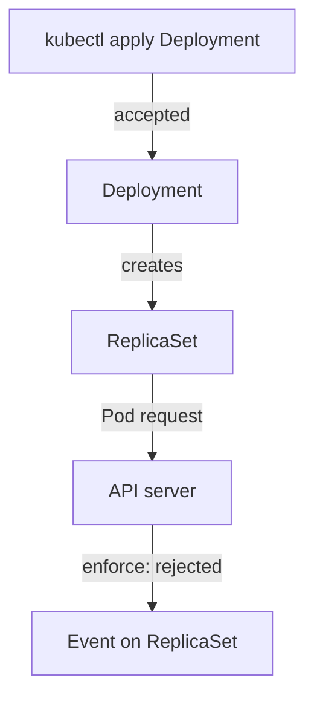

# Admission For Workloads And Troubleshooting

Most Pods are not created by a person. A Deployment creates a ReplicaSet, and the ReplicaSet creates the Pods. Pod Security Admission checks Pods, so the place where a rejection appears is not where you applied the YAML. This part follows a rejected Deployment to the object that holds the reason, and then covers exemptions and the checks to run when a Pod does not start.

## Which object is checked

The `enforce` mode checks Pod objects only. It does not check a Deployment, a StatefulSet or a Job. The API server accepts a Deployment whose Pod template violates the profile. Later, the ReplicaSet controller (a component of the `kube-controller-manager`) tries to create the Pods, and the API server rejects each one.

The `audit` and `warn` modes also look at workload resources. They check the Pod template inside a Deployment, a ReplicaSet, a Job, a CronJob, a DaemonSet and a StatefulSet. So `warn` tells you at `kubectl apply` time that a Deployment will produce Pods that violate the profile, while `enforce` alone stays silent until the Pods are created.



The diagram shows that the rejection is an event on the ReplicaSet, not an error on the command that applied the Deployment.

## Follow a rejected Deployment

Save this as `namespace-rollout-demo.yaml`:

<!-- astrona:playground:renew -->

```yaml
apiVersion: v1
kind: Namespace
metadata:
  name: rollout-demo
  labels:
    pod-security.kubernetes.io/enforce: restricted
```

Apply it:

```sh
kubectl apply -f namespace-rollout-demo.yaml
```

Save this Deployment as `deployment-scanner.yaml`. Its Pod template sets nothing about security:

```yaml
apiVersion: apps/v1
kind: Deployment
metadata:
  name: scanner
  namespace: rollout-demo
spec:
  replicas: 1
  selector:
    matchLabels:
      app: scanner
  template:
    metadata:
      labels:
        app: scanner
    spec:
      containers:
      - name: scanner
        image: docker.io/library/busybox:1.37.0
        command: ["sleep", "3600"]
```

Apply it:

```sh
kubectl apply -f deployment-scanner.yaml
```

Then check the result:

```sh
kubectl -n rollout-demo get deployment scanner
kubectl -n rollout-demo get replicaset
kubectl -n rollout-demo get events --field-selector reason=FailedCreate
```

The apply command prints `deployment.apps/scanner created`, so the Deployment was accepted. The `get deployment` output shows `0/1` in the `READY` column, and it stays at zero. The ReplicaSet exists, but it has zero Pods. The event list holds a `FailedCreate` event for the ReplicaSet. Its message says that creating the Pod was forbidden because it `violates PodSecurity "restricted:latest"`, followed by the same list of broken rules as a direct rejection.

Fix the Deployment by adding the missing fields to the Pod template. Save the full corrected file as `deployment-scanner.yaml`:

```yaml
apiVersion: apps/v1
kind: Deployment
metadata:
  name: scanner
  namespace: rollout-demo
spec:
  replicas: 1
  selector:
    matchLabels:
      app: scanner
  template:
    metadata:
      labels:
        app: scanner
    spec:
      securityContext:
        runAsNonRoot: true
        runAsUser: 1000
        seccompProfile:
          type: RuntimeDefault
      containers:
      - name: scanner
        image: docker.io/library/busybox:1.37.0
        command: ["sleep", "3600"]
        securityContext:
          allowPrivilegeEscalation: false
          capabilities:
            drop: ["ALL"]
```

Apply it and wait for the rollout:

```sh
kubectl apply -f deployment-scanner.yaml
kubectl -n rollout-demo rollout status deployment/scanner --timeout=120s
```

The template changed, so the Deployment creates a new ReplicaSet. The new Pod passes admission, and the rollout finishes with the message that the Deployment was successfully rolled out. The old ReplicaSet stays at zero Pods.

## Exemptions

Some Pods must break the rules. The control plane and node components, for example, often need host access. Pod Security Admission has an **exemptions** list for them. It is not a label. It is part of the admission configuration file that the API server reads when it starts, and it can exempt three things:

- `usernames`: requests from certain authenticated users.
- `runtimeClasses`: Pods that use certain RuntimeClass names.
- `namespaces`: whole namespaces.

The same file also sets the cluster-wide default profile for namespaces without labels. On a managed cluster you often cannot change this file, so you read its effect from the cluster instead. The `kube-system` namespace is commonly exempt or labeled Privileged for this reason.

## Troubleshooting checklist

When a Pod does not appear, work from the object that exists to the one that explains it:

1. Run `kubectl get namespace <name> --show-labels` and read the `pod-security.kubernetes.io/` labels, including the version.
2. If you applied a Pod, read the error. It lists every violated rule and names the container.
3. If you applied a Deployment, StatefulSet or Job, run `kubectl describe` on the Deployment, then on its ReplicaSet, and read the `FailedCreate` event. For a Job or DaemonSet, read the events of the Job or DaemonSet itself.
4. Fix the fields the message names, and apply again. Use `--dry-run=server` to test before you roll out.
5. If the Pod is admitted but the container does not start, read `kubectl describe pod`. The reason is a runtime or kubelet check, for example `CreateContainerConfigError` for `runAsNonRoot` with a root image.

You can now follow a rejection from a Deployment to its event, and you know which parts of the cluster configuration change what is checked. Pod Security Admission remains a check on the Pod spec only. It does not look at the image content, the network, Secrets or the application's own authorization.

## Common pitfalls

> [!WARNING]
> - **Looking for the error on the Deployment.** The Deployment is accepted. The reason is in the events of its ReplicaSet.
> - **Running `kubectl logs` on a Pod that was never created.** A rejected Pod has no logs. Read events instead.
> - **Assuming the Pod Security labels protect other namespaces.** Each namespace has its own labels. A new namespace without labels is unprotected.
> - **Treating a passing profile as a finished security review.** The profile checks settings in the spec. It does not check the image, the network or the application.
