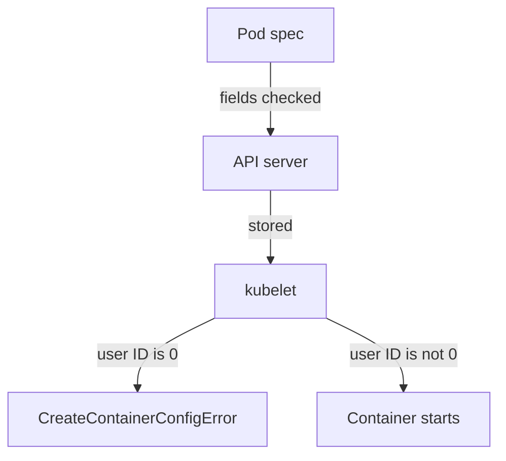

# Run As A Non-Root User

Linux decides what a process may do mostly by its user ID. User ID 0 is root, and root passes most permission checks. A container does not change this: the process in a container has a user ID, and the kernel on the node applies the same rules to it as to any other process. If an attacker takes over a container that runs as root, the attacker starts with the strongest identity the container allows. This part shows how a Pod chooses its user, how to see the result, and what goes wrong when the image and the Pod disagree.

## Where the user ID comes from

Every container image can declare a default user with the `USER` instruction in its build file. If the image declares none, the container runs as root. A Pod can override the image with the fields `runAsUser` and `runAsGroup`, which set the numeric user ID and group ID of the container process. They exist at the Pod level (`spec.securityContext`) and at the container level (`spec.containers[].securityContext`), and the container value wins.

The field `runAsNonRoot` does not choose a user. It is a check. When it is `true`, the kubelet (the node agent that starts containers) reads the final user ID and refuses to start the container if that ID is 0. The check needs a number. If the image declares its user by name, for example `USER appuser`, the kubelet cannot tell whether that name maps to 0, so it refuses to start the container unless the Pod also sets `runAsUser`.

The field `fsGroup` handles files. It names a group ID that the kubelet applies to the volumes it mounts. Files in a supported volume get that group as owner, and the container process receives it as a supplementary group. A non-root process can then write to the volume.

## See the user of a container

Create a namespace for the examples:

<!-- astrona:playground:renew -->

```sh
kubectl create namespace users-demo
```

Save a Pod that sets nothing about users as `pod-default-user.yaml`:

```yaml
apiVersion: v1
kind: Pod
metadata:
  name: default-user
  namespace: users-demo
spec:
  containers:
  - name: check
    image: docker.io/library/busybox:1.37.0
    command: ["sleep", "3600"]
```

Apply it and print the identity of the process:

```sh
kubectl apply -f pod-default-user.yaml
kubectl -n users-demo wait --for=condition=Ready pod/default-user --timeout=120s
kubectl -n users-demo exec default-user -- id
```

The `id` command prints `uid=0(root)`, because the `busybox` image declares no user. Now save a Pod that sets a user, a group and an `fsGroup`, and mounts a volume, as `pod-chosen-user.yaml`:

```yaml
apiVersion: v1
kind: Pod
metadata:
  name: chosen-user
  namespace: users-demo
spec:
  securityContext:
    runAsUser: 10001
    runAsGroup: 10001
    fsGroup: 20001
  containers:
  - name: check
    image: docker.io/library/busybox:1.37.0
    command: ["sleep", "3600"]
    volumeMounts:
    - name: data
      mountPath: /data
  volumes:
  - name: data
    emptyDir: {}
```

Apply it and look at the identity and at the volume:

```sh
kubectl apply -f pod-chosen-user.yaml
kubectl -n users-demo wait --for=condition=Ready pod/chosen-user --timeout=120s
kubectl -n users-demo exec chosen-user -- id
kubectl -n users-demo exec chosen-user -- ls -ld /data
```

The `id` output shows user ID 10001 and group ID 10001, and it lists 20001 among the groups. The `ls` output shows that `/data` belongs to group 20001 and that the group may write. The kubelet set that group on the `emptyDir` volume because of `fsGroup`, and the process can write to the volume without being root. A user ID such as 10001 does not need an entry in `/etc/passwd` in the image. The kernel only uses the number.

## When the image and the Pod disagree

`runAsNonRoot: true` on an image that runs as root produces a Pod that the API server accepts and the kubelet refuses to start. Save this as `pod-nonroot-check.yaml`:

```yaml
apiVersion: v1
kind: Pod
metadata:
  name: nonroot-check
  namespace: users-demo
spec:
  securityContext:
    runAsNonRoot: true
  containers:
  - name: check
    image: docker.io/library/busybox:1.37.0
    command: ["sleep", "3600"]
```

Apply it and read the state:

```sh
kubectl apply -f pod-nonroot-check.yaml
kubectl -n users-demo get pod nonroot-check
kubectl -n users-demo describe pod nonroot-check
```

The apply command succeeds, so admission has no objection. The `STATUS` column shows `CreateContainerConfigError`, and the events at the end of the `describe` output say that the container has `runAsNonRoot` and that the image will run as root. The fix is to add `runAsUser` with a number other than zero. The kubelet, not the API server, raised the error, because only the kubelet knows the user that the image declares.

The flow is this: the Pod spec says which user to run as, the API server and Pod Security Admission check the fields, and the kubelet checks the final user ID when it creates the container. A Pod can pass the first two and fail the third.



The diagram shows that Pod Security Admission checks the fields, while the kubelet checks the real user ID at start time.

You can now choose a user for a workload and read the failure when the choice conflicts with the image. Running as a non-root user removes the strongest identity, but a process can still hold powers that do not depend on its user ID. The next part covers those powers.

## Common pitfalls

> [!WARNING]
> - **Setting `runAsNonRoot: true` and nothing else.** On a root image the Pod is admitted and then stuck in `CreateContainerConfigError`. Set `runAsUser` to a non-zero number.
> - **Relying on a named `USER` in the image.** The kubelet cannot verify a name, so it refuses the container. Use a numeric user ID.
> - **Forgetting `fsGroup` for a volume.** A non-root process that is not in the owner group of a mounted volume gets `Permission denied` on write.
> - **Reading `runAsNonRoot` as a user setting.** It only checks. `runAsUser` chooses.
