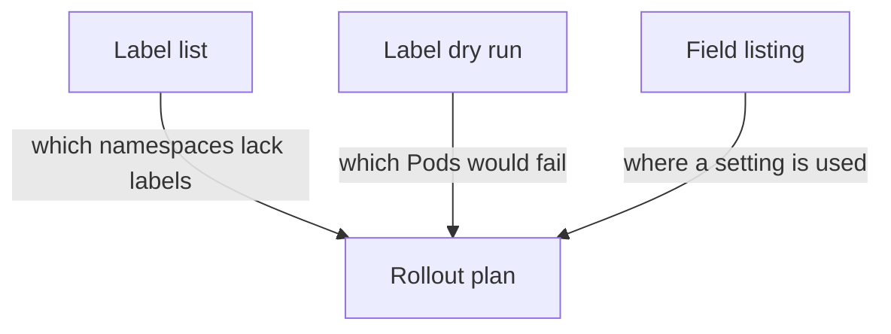

# Inventory Before You Label

A label on a namespace takes effect at once for every new Pod in it. If an application restarts after the label is set and its Pod does not meet the profile, the Pod is not created, and the application loses capacity. The safe habit is to look first: which namespaces already have labels, which workloads would fail a stricter profile, and which of those failures matter. This part shows three read-only ways to build that inventory.

## List the labels that exist

The first question is which namespaces are protected. The `-L` option of `kubectl get` adds a column for a label key. List the three mode labels for every namespace:

<!-- astrona:playground:renew -->

```sh
kubectl get namespaces -L pod-security.kubernetes.io/enforce,pod-security.kubernetes.io/warn,pod-security.kubernetes.io/audit
```

An empty cell means that the namespace has no label for that mode. For a namespace with an empty `enforce` cell, the cluster default applies, and unless an administrator changed the default it is Privileged. The list is the starting point of the plan. Namespaces that run application workloads and have no label are the ones to work on first.

## Ask the API server what a label would break

You do not need to guess which workloads fail a profile. A server-side dry run of a label change makes the API server evaluate every existing Pod in the namespace against the new profile and print a warning for each Pod that fails. Nothing changes. Try Baseline on the `starfleet` namespace:

```sh
kubectl label namespace starfleet pod-security.kubernetes.io/enforce=baseline --overwrite --dry-run=server
```

The command ends with `namespace/starfleet labeled (server dry run)`. If any Pod in the namespace broke Baseline, a warning line before it would name the Pod and the rule. The `probe` Pods run as root with default capabilities, and Baseline allows that, so this command gives no Pod warning. Now ask the same question for Restricted:

```sh
kubectl label namespace starfleet pod-security.kubernetes.io/enforce=restricted --overwrite --dry-run=server
```

This time the output has a warning for each Pod in `starfleet`. Each line starts with the Pod name and lists the rules it breaks, for example `allowPrivilegeEscalation != false`, `unrestricted capabilities`, `runAsNonRoot != true` and `seccompProfile`. The `probe` and `shuttle` Pods are named. The same two commands answer the whole question: Baseline can be enforced now, and Restricted needs changes to the workloads first.

You can ask for every namespace at once with the `--all` option. The command is read-only because of `--dry-run=server`:

```sh
kubectl label namespaces --all pod-security.kubernetes.io/enforce=baseline --overwrite --dry-run=server
```

The output has one warning block per namespace that would break. The system namespaces appear in it, because node agents and networking components often use host networking or extra capabilities. They are a reason to treat `kube-system` and similar namespaces differently, which the last part of this module covers.

## Find specific settings across the cluster

A dry run reports what a profile rejects. Sometimes you need the reverse: a list of the Pods that use one specific setting. The `custom-columns` output of `kubectl get` prints chosen fields of every Pod. This command lists the namespace, name and host-network setting:

```sh
kubectl get pods --all-namespaces -o custom-columns=NAMESPACE:.metadata.namespace,NAME:.metadata.name,HOSTNETWORK:.spec.hostNetwork
```

A value of `true` means that the Pod uses the network namespace of the node. An empty value means the field is not set. Replace the field path to look at another setting, for example `.spec.securityContext.runAsNonRoot` to see which Pods ask for a non-root user.

Three sources therefore build the inventory. The label list shows what is configured. The label dry run shows what would break. The field listing shows where one risky setting is used. Each one is read-only, and each one can run again after every change to see the effect.



The diagram shows that the plan combines three read-only inputs, and that none of them changes the cluster.

You now have a list of namespaces and a list of failing Pods. The next step is to change the labels in an order that gives the owners time to react.

## Common pitfalls

> [!WARNING]
> - **Skipping the dry run because the namespace looks small.** One Pod that restarts after the label can leave an application without capacity.
> - **Reading an empty `enforce` cell as safe.** It means the cluster default applies, and the default is usually Privileged.
> - **Running the label command without `--dry-run=server`.** It applies the label. The warnings appear in both cases, so add the option on the first run.
> - **Forgetting the system namespaces in the `--all` result.** Their warnings are expected. Do not enforce a strict profile on them without a separate decision.
