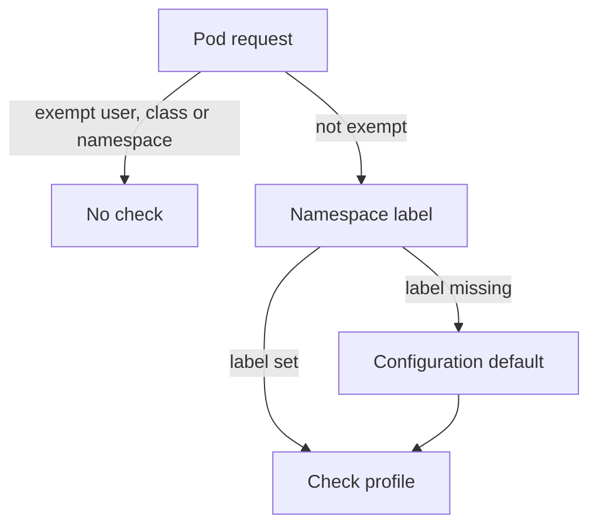

# Cluster-Wide Defaults And Exemptions

Namespace labels are only half of the configuration. A new namespace has no labels, and some requests must never be checked, such as those of the components that run the cluster. Both cases are decided by a file that the API server reads at start. This part explains what that file contains, how the API server finds it, and how to see from a running cluster whether it is in use.

## The admission configuration file

The Pod Security Admission plugin accepts a configuration object of kind `PodSecurityConfiguration`. An administrator wraps it in an `AdmissionConfiguration` file and gives the path of the file to the API server with the flag `--admission-control-config-file`. The file has two parts.

The `defaults` part sets the profile and the version for each mode. These values apply to every namespace that has no label for that mode. The built-in default is `privileged` for `enforce`, `audit` and `warn`, with the version `latest`. A namespace label for a mode always replaces the default for that mode.

The `exemptions` part lists requests that skip all three checks. It can name three things:

- `usernames`: the authenticated user names of the requesters, for example a controller account.
- `runtimeClasses`: RuntimeClass names. A Pod that uses one of them is exempt.
- `namespaces`: namespaces whose Pods are never checked.

A file that sets a baseline default and exempts `kube-system` looks like this. It is shown for reading and is not applied in the playground:

```yaml
apiVersion: apiserver.config.k8s.io/v1
kind: AdmissionConfiguration
plugins:
- name: PodSecurity
  configuration:
    apiVersion: pod-security.admission.config.k8s.io/v1
    kind: PodSecurityConfiguration
    defaults:
      enforce: baseline
      enforce-version: latest
      audit: restricted
      audit-version: latest
      warn: restricted
      warn-version: latest
    exemptions:
      usernames: []
      runtimeClasses: []
      namespaces:
      - kube-system
```

With this file, a namespace with no labels enforces Baseline and audits and warns on Restricted. The namespace `kube-system` is never checked. Because an exemption skips the check completely, it is the most powerful setting in the configuration. An exempt user name or namespace can create a privileged Pod without any warning, so keep the lists short and review them.

## Find the configuration on a running cluster

On a self-managed cluster built with `kubeadm`, the API server runs as a static Pod. The kubelet starts it from a manifest file on the control-plane node, and the manifest holds the flags. The file that the flag names must exist on the node and must be mounted into the Pod, so a change to the defaults is a change to that manifest. A managed cluster does not give access to the manifest, so the effects are observed instead.

Read the flags of the API server in the playground. The Pod has the label `component=kube-apiserver`:

<!-- astrona:playground:renew -->

```sh
kubectl -n kube-system get pods -l component=kube-apiserver -o jsonpath='{.items[0].spec.containers[0].command}' | tr ',' '\n' | grep -E 'admission|enable'
```

The command prints the flags that contain `admission` or `enable`. Look for `--admission-control-config-file`. If the flag is not in the list, the API server uses the built-in defaults and no exemptions. The flag `--enable-admission-plugins` lists plugins that are switched on in addition to the default ones; Pod Security Admission is on by default and does not need to appear.

You can also observe the effect without the manifest. Create a namespace with no labels and send a privileged Pod to it as a server-side dry run. Save this Pod as `pod-privileged-default.yaml`:

```yaml
apiVersion: v1
kind: Pod
metadata:
  name: privileged-default
  namespace: defaults-demo
spec:
  containers:
  - name: check
    image: docker.io/library/busybox:1.37.0
    command: ["sleep", "3600"]
    securityContext:
      privileged: true
```

Create the namespace and send the Pod:

```sh
kubectl create namespace defaults-demo
kubectl apply -f pod-privileged-default.yaml --dry-run=server
```

With the built-in defaults, the request is accepted and the second command ends with `created (server dry run)`. The namespace has no label, the default profile is Privileged, and nothing is checked. If a cluster in your care rejects this request, its configuration file sets a stricter default. That is the quickest way to learn what a cluster does when you cannot read its manifest.

Check which namespaces carry labels of their own, and read the labels of `kube-system`:

```sh
kubectl get namespace kube-system --show-labels
```

If the namespace carries no `pod-security.kubernetes.io/` label, its Pods are governed by the defaults, or by an exemption in the file.

## How the three layers combine

For each Pod, the API server decides in this order. First it checks the exemptions: an exempt user name, RuntimeClass or namespace skips the checks. If no exemption applies, it reads the labels of the namespace for each mode. For a mode without a label, it uses the default from the configuration file.



The diagram shows that an exemption comes first, then the namespace label, then the default from the configuration file.

You now know where each decision is made. The labels are in the cluster API and any user with the right permission can change them. The configuration file is on the control-plane node, outside the API. The last part of this module covers how to handle workloads that need an exception, and how to protect both layers.

## Common pitfalls

> [!WARNING]
> - **Looking for exemptions in namespace labels.** Exemptions exist only in the admission configuration file.
> - **Using the exemption list for convenience.** An exempt namespace or user name bypasses every check, including `enforce`.
> - **Editing the manifest of the API server without a backup.** A syntax error in a static Pod manifest keeps the API server from starting.
> - **Assuming a managed cluster uses the built-in defaults.** The provider may set stricter defaults. Test with a dry run.
