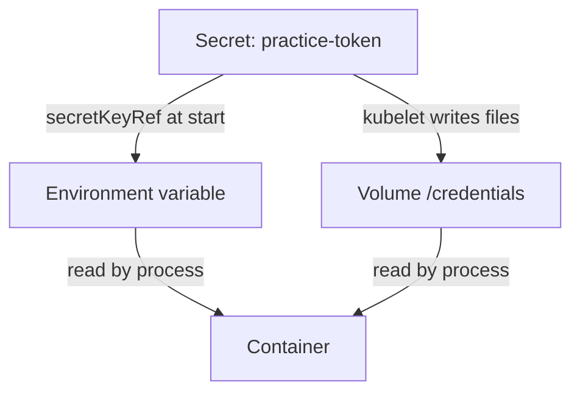

# Delivering Secrets To Pods

A Secret in the API does nothing until a container reads it. Kubernetes offers two ways to hand a Secret to a container: as an environment variable and as a file in a volume. They look similar in a manifest, but the container sees different things, a leaked value has different paths, and a changed value arrives differently. This part builds one Pod that uses both and compares them.

## Two delivery paths

A Secret key can be injected in two ways:

- **Environment variable.** The field `env[].valueFrom.secretKeyRef` copies one key into a variable when the container starts. The field `envFrom` with `secretRef` copies every key of a Secret as variables named after the keys.
- **Secret volume.** A volume with `secret.secretName` mounts every key of the Secret as a file in a directory. The kubelet creates the files. The kubelet is the agent on each node that starts the containers of the Pods assigned to that node.

The kubelet puts the files of a Secret volume on a `tmpfs`, a memory-backed filesystem, so the values are not written to the node disk. The default file mode is `0644`. The field `defaultMode` on the volume, or `mode` on one item, changes it.

## Deliver one Secret both ways

Save this as `pod-delivery-reader.yaml`:

<!-- astrona:playground:renew -->

```yaml
apiVersion: v1
kind: Pod
metadata:
  name: delivery-reader
  namespace: starfleet
spec:
  restartPolicy: Never
  containers:
  - name: reader
    image: docker.io/library/busybox:1.37.0
    command: ["sleep", "3600"]
    env:
    - name: PRACTICE_TOKEN
      valueFrom:
        secretKeyRef:
          name: practice-token
          key: token
    volumeMounts:
    - name: credentials
      mountPath: /credentials
      readOnly: true
  volumes:
  - name: credentials
    secret:
      secretName: practice-token
      defaultMode: 0400
```

Apply it:

```sh
kubectl apply -f pod-delivery-reader.yaml
kubectl -n starfleet wait --for=condition=Ready pod/delivery-reader --timeout=120s
```

Then check the result. These commands test the value without printing a credential. They print only the word `match` or `different`:

```sh
kubectl -n starfleet exec delivery-reader -- sh -c 'test "$PRACTICE_TOKEN" = disposable-v1 && echo match || echo different'
kubectl -n starfleet exec delivery-reader -- sh -c 'test "$(cat /credentials/token)" = disposable-v1 && echo match || echo different'
```

Both commands print `match`: the same value arrived by two paths. The container saw the environment variable as a normal variable of its process and the key `token` as a file named `/credentials/token`.

Look at the files themselves:

```sh
kubectl -n starfleet exec delivery-reader -- ls -la /credentials
kubectl -n starfleet exec delivery-reader -- ls -lL /credentials/token
```

The first listing shows that `token` is a symbolic link that points into a directory named `..data`, which in turn points at a timestamped directory. The kubelet uses this layout to replace all files at once when a Secret changes. The second listing follows the link and shows the permissions `-r--------`, which come from `defaultMode: 0400`.

## Compare the two paths

The environment variable is easy to use and hard to contain. A child process inherits it. A crash dump, a debug endpoint or a log line that prints the environment exposes it. Anyone who can `exec` into the container can read it with `env`. The value is also in `/proc/<pid>/environ` of the process.

The volume avoids the environment and lets you set file permissions. It also lets a changed Secret reach a running container, as the next part shows. A file can still be read by anything that runs as the same user in the container.



The diagram shows that both paths start at the same Secret, and that the kubelet writes the volume files and passes the environment variable to the container runtime when it starts the container.

Several details matter on the exam:

- The kubelet needs the Secret to exist before it starts the container, unless the reference has `optional: true`. A missing Secret leaves the Pod in `ContainerCreating` for a volume, or in `CreateContainerConfigError` for an environment variable.
- A Pod can reference only Secrets in its own namespace.
- A mount with `subPath` copies the file once and never receives updates.

You now know the two delivery paths and what the container sees on each. The open question is what happens to those paths when the Secret changes.

## Common pitfalls

> [!WARNING]
> - **Printing the credential to test it.** Compare the value inside the container and print only the result.
> - **Assuming an environment variable is safer than a file.** Child processes, crash dumps and `/proc/<pid>/environ` all expose it.
> - **Referencing a Secret from another namespace.** A Pod can use only Secrets from its own namespace.
> - **Mounting with `subPath` and expecting updates.** A `subPath` mount never changes after the container starts.
