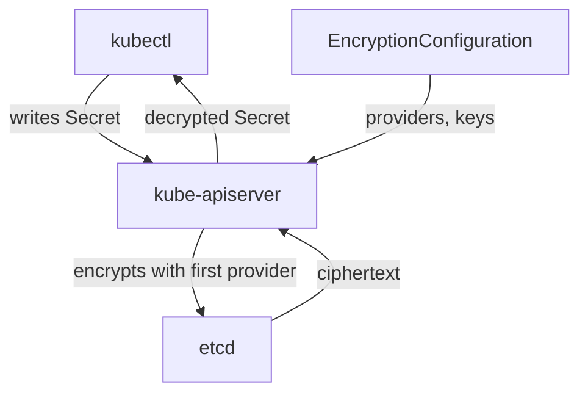

---
exam_objectives:
- Manage Kubernetes secrets
---
# Encryption At Rest

The Kubernetes API server stores every object in `etcd`, a key-value database. By default it writes Secrets there as plain data, in the same encoding the API returns. Anyone who can read the `etcd` data directory, a snapshot or a backup reads every Secret in the cluster. Encryption at rest closes that gap: the API server encrypts the data before it writes it, and decrypts it when it reads it.

This part shows the gap on the playground first, then writes the configuration file, changes the kube-apiserver and proves in `etcd` that the data is encrypted. All steps run on the playground VM (virtual machine), which is the control-plane node of a kubeadm cluster.

## See a Secret in etcd

To prove anything about encryption, you must read `etcd` directly. The API cannot show it, because it always decrypts for you. On the playground, `etcd` runs as a container on the node, and its client tool `etcdctl` is inside that container. The container runtime command `crictl` runs a command in it.

<!-- astrona:playground:renew -->

Open a shell on the VM with `astrona ssh astro-ats-034-playground-020-01`. Define a small helper that reads one key from `etcd` with the client certificates of the node, then create a Secret and read its stored form. The key of a Secret in `etcd` is `/registry/secrets/<namespace>/<name>`:

```sh
etcd_get() {
  sudo crictl exec "$(sudo crictl ps --name etcd -q)" etcdctl \
    --cacert=/etc/kubernetes/pki/etcd/ca.crt \
    --cert=/etc/kubernetes/pki/etcd/server.crt \
    --key=/etc/kubernetes/pki/etcd/server.key \
    get "$1"
}
kubectl -n starfleet create secret generic before-encryption --from-literal=token=disposable-before
etcd_get /registry/secrets/starfleet/before-encryption | hexdump -C | head -5
etcd_get /registry/secrets/starfleet/before-encryption | grep -a -o 'disposable-[a-z]*'
```

The output on the playground was:

```text
secret/before-encryption created
00000000  2f 72 65 67 69 73 74 72  79 2f 73 65 63 72 65 74  |/registry/secret|
00000010  73 2f 73 74 61 72 66 6c  65 65 74 2f 62 65 66 6f  |s/starfleet/befo|
00000020  72 65 2d 65 6e 63 72 79  70 74 69 6f 6e 0a 6b 38  |re-encryption.k8|
00000030  73 00 0a 0c 0a 02 76 31  12 06 53 65 63 72 65 74  |s.....v1..Secret|
00000040  12 e2 01 0a bb 01 0a 11  62 65 66 6f 72 65 2d 65  |........before-e|
disposable-before
```

The stored value starts with `k8s` and a zero byte, which is the plain protobuf (Protocol Buffers, a binary encoding) format of the API server. The last line shows that the value `disposable-before` sits in `etcd` as readable text. Anyone with a copy of the `etcd` data can read it the same way.

## The EncryptionConfiguration file

An **EncryptionConfiguration** is a file on the control-plane node that tells the kube-apiserver which resources to encrypt and with which provider. A provider is one method of encryption, with its keys. The API server reads the file through the flag `--encryption-provider-config`. It is not a Kubernetes object, so you cannot apply it with `kubectl`.

The list of `providers` is ordered, and the order has two meanings:

- For a **write**, the API server uses the first provider. With `aescbc` first, new and updated Secrets are encrypted.
- For a **read**, the API server tries the providers in order until one can decrypt the stored data. The provider `identity` stores and reads plain data. With `identity` last, Secrets that were stored before encryption can still be read.

If you put `identity` first, nothing is encrypted, and the file still looks correct. This is the most common mistake. The main providers are:

- `aescbc`: AES (Advanced Encryption Standard) in CBC (cipher block chaining) mode, with a 16, 24 or 32 byte key stored in the file. Kubernetes documents it as not recommended because of a weakness of CBC, but it is widely used and common in exam tasks.
- `aesgcm`: AES in GCM (Galois/Counter Mode). A key must not be used for too many writes, so it needs regular key rotation.
- `secretbox`: XSalsa20 and Poly1305, with a 32 byte key in the file. Kubernetes documents it as a strong local choice.
- `kms` version 2: the API server asks an external KMS (key management service) to wrap its data keys. The main key never leaves the KMS, so it is not on the control-plane node.

Generate a random 32 byte key and encode it in base64:

```sh
head -c 32 /dev/urandom | base64
```

Save this as `encryptionconfiguration.yaml`, with the printed value in place of `<KEY>`:

```yaml
apiVersion: apiserver.config.k8s.io/v1
kind: EncryptionConfiguration
resources:
- resources:
  - secrets
  providers:
  - aescbc:
      keys:
      - name: key1
        secret: <KEY>
  - identity: {}
```

Anyone who can read this file can decrypt the data, so only root may read it. Copy it to a directory on the node and set the mode to `600`:

```sh
sudo mkdir -p /etc/kubernetes/enc
sudo cp encryptionconfiguration.yaml /etc/kubernetes/enc/enc.yaml
sudo chmod 600 /etc/kubernetes/enc/enc.yaml
sudo ls -l /etc/kubernetes/enc
rm encryptionconfiguration.yaml
```

The listing on the playground showed the file owned by root with mode `600`:

```text
total 4
-rw------- 1 root root 239 Nov 18 11:31 enc.yaml
```

## Change the kube-apiserver static pod

On a kubeadm cluster the kube-apiserver runs as a static pod. A static pod is a pod that the kubelet, the agent on each node, starts from a manifest file in `/etc/kubernetes/manifests`, without the API server. When the file changes, the kubelet restarts the pod. Keep a backup outside that folder first, because the kubelet would also read a copy left inside it:

```sh
sudo mkdir -p /root/backup
sudo cp -p /etc/kubernetes/manifests/kube-apiserver.yaml /root/backup/kube-apiserver.yaml
sudo vi /etc/kubernetes/manifests/kube-apiserver.yaml
```

Make three changes in the file. Add the flag `- --encryption-provider-config=/etc/kubernetes/enc/enc.yaml` under `- kube-apiserver` in the `command` list. Add a read-only `volumeMount` for `/etc/kubernetes/enc` to the container. Add a `hostPath` volume with the same path under `volumes`, so the file on the node is visible inside the container. Then compare the result with the backup:

```sh
sudo diff /root/backup/kube-apiserver.yaml /etc/kubernetes/manifests/kube-apiserver.yaml
```

On the playground, `diff` printed exactly the three additions:

```text
14a15
>     - --encryption-provider-config=/etc/kubernetes/enc/enc.yaml
81a83,85
>     - mountPath: /etc/kubernetes/enc
>       name: enc
>       readOnly: true
103a108,111
>   - hostPath:
>       path: /etc/kubernetes/enc
>       type: DirectoryOrCreate
>     name: enc
```

The kubelet now stops the old kube-apiserver and starts a new one. During the restart, `kubectl` cannot reach the API. Wait until the API server answers its readiness check, then confirm the new container:

```sh
until kubectl get --raw=/readyz 2>/dev/null; do sleep 5; done; echo
sudo crictl ps --name kube-apiserver
```

On the playground the API server was ready after about 45 seconds. The `crictl ps` output showed one `kube-apiserver` container in the state `Running`, created `4 seconds ago`, with `ATTEMPT` 0 (shortened here to those columns). If the API never comes back, the kube-apiserver failed to start: read its log with `sudo crictl ps -a --name kube-apiserver` and `sudo crictl logs <CONTAINER-ID>`, or restore the backup.

## Prove that new Secrets are encrypted

Create a second Secret and read its stored form, the same way as before. Then count how many times the text `disposable` appears in the stored form of each Secret:

```sh
kubectl -n starfleet create secret generic after-encryption --from-literal=token=disposable-after
etcd_get /registry/secrets/starfleet/after-encryption | hexdump -C | head -5
etcd_get /registry/secrets/starfleet/after-encryption | grep -a -c disposable
etcd_get /registry/secrets/starfleet/before-encryption | grep -a -c disposable
```

The output on the playground was:

```text
secret/after-encryption created
00000000  2f 72 65 67 69 73 74 72  79 2f 73 65 63 72 65 74  |/registry/secret|
00000010  73 2f 73 74 61 72 66 6c  65 65 74 2f 61 66 74 65  |s/starfleet/afte|
00000020  72 2d 65 6e 63 72 79 70  74 69 6f 6e 0a 6b 38 73  |r-encryption.k8s|
00000030  3a 65 6e 63 3a 61 65 73  63 62 63 3a 76 31 3a 6b  |:enc:aescbc:v1:k|
00000040  65 79 31 3a e0 43 36 c4  40 30 80 c8 ac 85 16 79  |ey1:.C6.@0.....y|
0
1
```

The new value starts with `k8s:enc:aescbc:v1:key1:`. This prefix names the provider and the key, and the bytes after it are ciphertext. The count `0` shows that the new value is not readable in `etcd`. The count `1` shows the gap that is left: `before-encryption` is still plain, because the API server encrypts an object only when it writes it.



The diagram shows that the kube-apiserver holds the keys, so `etcd` stores only ciphertext and `kubectl` still receives the decrypted Secret.

## Rewrite the existing Secrets

To encrypt the old Secrets, make the API server write each one again. The `kubectl replace` command sends every Secret back unchanged, and the API server stores it through the first provider:

```sh
kubectl get secrets --all-namespaces -o json | kubectl replace -f -
etcd_get /registry/secrets/starfleet/before-encryption | hexdump -C | head -5
etcd_get /registry/secrets/starfleet/before-encryption | grep -a -c disposable
kubectl -n starfleet get secret before-encryption -o jsonpath='{.data.token}' | base64 -d; echo
```

The output on the playground was:

```text
secret/bootstrap-token-vvo6vy replaced
secret/after-encryption replaced
secret/before-encryption replaced
secret/practice-token replaced
00000000  2f 72 65 67 69 73 74 72  79 2f 73 65 63 72 65 74  |/registry/secret|
00000010  73 2f 73 74 61 72 66 6c  65 65 74 2f 62 65 66 6f  |s/starfleet/befo|
00000020  72 65 2d 65 6e 63 72 79  70 74 69 6f 6e 0a 6b 38  |re-encryption.k8|
00000030  73 3a 65 6e 63 3a 61 65  73 63 62 63 3a 76 31 3a  |s:enc:aescbc:v1:|
00000040  6b 65 79 31 3a 0b 70 a4  56 f6 38 9f 85 10 e5 f6  |key1:.p.V.8.....|
0
disposable-before
```

`before-encryption` now has the same `k8s:enc:aescbc:v1:key1:` prefix, and its plain text is gone from `etcd`. The last line shows that the API still returns the value, because the kube-apiserver decrypts it for an authorized user. Encryption at rest protects copies of `etcd`; it does not protect a Secret from a user that RBAC (role-based access control) allows to read it.

You now know how to enable encryption at rest, how to prove it in `etcd`, and why the rewrite step matters. Every Secret in the cluster is now stored with `key1`. The open question is what happens when that key must be replaced: the kube-apiserver needs `key1` to read every stored Secret, so a new key cannot simply take its place in the file.

## Common pitfalls

> [!WARNING]
> - **Putting `identity` first.** The first provider encrypts new writes, so `identity` first means no encryption.
> - **Skipping the rewrite.** Secrets stored before the change stay plain until you write them again.
> - **Forgetting the volume mount.** The API server cannot read a file that is not mounted in its container, and it does not start.
> - **Leaving a backup in `/etc/kubernetes/manifests`.** The kubelet reads every file in that folder as a static pod.
> - **Checking encryption with `kubectl`.** The API decrypts for you. Read `etcd` directly.
