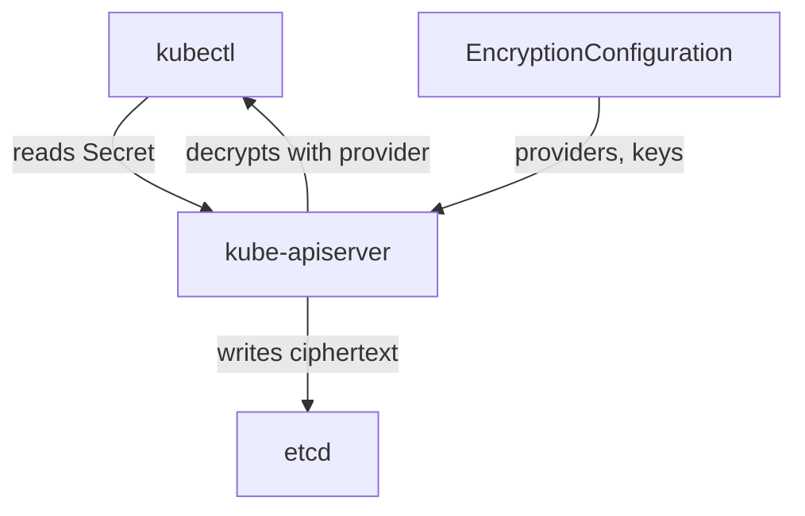

# Encryption At Rest

The Kubernetes API server stores every object in `etcd`, a key-value database. By default it writes Secrets there as plain data, in the same encoding the API returns. Anyone who can read the `etcd` data directory, a snapshot or a backup reads every Secret in the cluster. Encryption at rest closes that gap: the API server encrypts the data before it writes it, and decrypts it when it reads it. This part explains the configuration file, the choices in it, and how to prove that it works.

This part describes the procedure on a cluster where you control the control-plane node, for example one built with `kubeadm`. The playground node is a container that you cannot reconfigure safely, so read the steps and commands here as reference; run none of them in the playground.

## The EncryptionConfiguration file

An **EncryptionConfiguration** is a file on the control-plane node that tells the `kube-apiserver` which resources to encrypt and with which provider. The API server reads it through the flag `--encryption-provider-config`. It is not a Kubernetes object; you cannot apply it with `kubectl`.

```yaml
apiVersion: apiserver.config.k8s.io/v1
kind: EncryptionConfiguration
resources:
  - resources:
      - secrets
    providers:
      - aescbc:
          keys:
            - name: key1
              secret: <BASE64-ENCODED-32-BYTE-KEY>
      - identity: {}
```

The list of `providers` is ordered, and the order has two meanings:

- For a **write**, the API server uses the first provider. Here that is `aescbc`, so new and updated Secrets are encrypted.
- For a **read**, the API server tries the providers in order until one can decrypt the stored data. The provider `identity` stores and reads plain data. It is last here, so Secrets that were stored before encryption was enabled can still be read.

If you put `identity` first, nothing is encrypted, and the configuration looks correct. This is the most common mistake.

The main providers are:

- `aescbc`: AES in CBC mode, with a 16, 24 or 32 byte key stored in the file. Kubernetes documents it as not recommended, because CBC is vulnerable to padding oracle attacks in theory, but it is widely used.
- `aesgcm`: AES in GCM mode. It needs a key rotation routine, because a key must not be used for too many writes.
- `secretbox`: XSalsa20 and Poly1305, with a 32 byte key in the file. Kubernetes documents it as a strong local choice.
- `kms` (version 2): the API server sends a data encryption key to an external key management service, which wraps it with a key that never leaves the service. This is the strongest option, because the key is not on the control-plane node.

The key in the file protects the data in `etcd`, but the file is on the control-plane node. Anyone who can read the file can decrypt the data. Set the file mode so only root can read it.

## Enable it on a kubeadm cluster

On a `kubeadm` cluster the `kube-apiserver` runs as a static Pod defined by a manifest on the control-plane node, in `/etc/kubernetes/manifests/kube-apiserver.yaml`. The steps are:

1. Generate a 32 byte key and encode it: `head -c 32 /dev/urandom | base64`.
2. Save the configuration file in a directory on the node, for example `/etc/kubernetes/enc/enc.yaml`, readable only by root.
3. Edit the static Pod manifest. Add the flag `--encryption-provider-config=/etc/kubernetes/enc/enc.yaml`. Add a `hostPath` volume for `/etc/kubernetes/enc` and a read-only `volumeMount` for the same path in the `kube-apiserver` container, so the file is visible inside it.
4. The kubelet restarts the API server when the manifest changes. Wait until `kubectl get nodes` works again.

Existing Secrets are still plain in `etcd`. Encryption applies when an object is written. Force a write of every Secret, so each one is stored again through the first provider:

```sh
kubectl get secrets --all-namespaces -o json | kubectl replace -f -
```

## Prove the data is encrypted

The proof reads `etcd` directly, not the API. Run it on the control-plane node, with the `etcdctl` tool and the paths to the `etcd` client certificates (on `kubeadm` they are in `/etc/kubernetes/pki/etcd`). The key of a Secret in `etcd` is `/registry/secrets/<namespace>/<name>`:

```sh
ETCDCTL_API=3 etcdctl \
  --cacert=/etc/kubernetes/pki/etcd/ca.crt \
  --cert=/etc/kubernetes/pki/etcd/server.crt \
  --key=/etc/kubernetes/pki/etcd/server.key \
  get /registry/secrets/starfleet/practice-token | hexdump -C | head
```

With encryption working, the stored value starts with the text `k8s:enc:aescbc:v1:key1`, which names the provider and the key, followed by unreadable bytes. Before encryption, the value contains the plain text of the key and of the secret. At the same time, `kubectl get secret practice-token -o yaml` still shows base64 data, because the API server decrypts it for an authorized user.



The diagram shows that the API server holds the keys, encrypts on write and decrypts on read, so `etcd` only ever stores ciphertext.

## Rotate the encryption key

To change the key without losing data, add the new key first in the list, keep the old key after it, restart the API server, and rewrite all Secrets with the `kubectl replace` command from above. Once every Secret is stored with the new key, remove the old key and restart the API server again. If you remove the old key before the rewrite, Secrets that are still encrypted with it can no longer be read.

You now know where Secrets are exposed and how each control closes one gap: RBAC limits who reads through the API, volumes and file modes limit what a container sees, and encryption at rest protects the stored data. Encryption at rest does not protect a Secret from a user the API server authorizes.

## Common pitfalls

> [!WARNING]
> - **Putting `identity` first.** The first provider encrypts new writes, so `identity` first means no encryption.
> - **Skipping the rewrite.** Secrets stored before the change stay unencrypted until you write them again.
> - **Forgetting the volume mount.** The API server cannot read a configuration file that is not mounted in its container, and it does not start.
> - **Believing the key file is safe on the node.** The key is on the control-plane node next to the data. A key management service (KMS provider) keeps the key outside.
> - **Checking encryption with `kubectl`.** The API decrypts for you. Read `etcd` directly.
