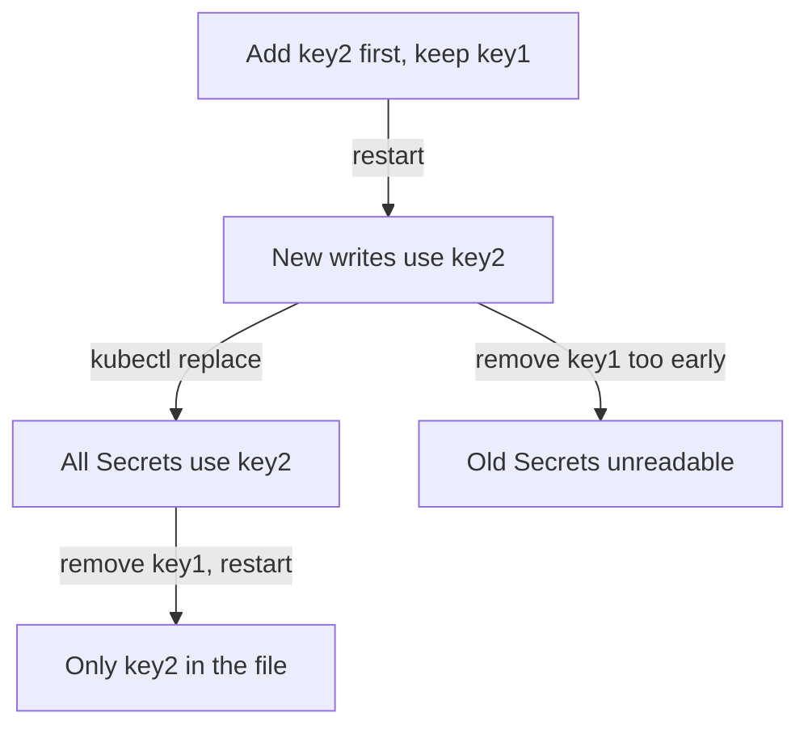

---
exam_objectives:
- Manage Kubernetes secrets
---
# Rotating The Encryption Key

An encryption key should not stay in use forever. A key can leak with a backup of the control-plane node, a person who knew it can leave the team, or a security policy can require a new key every year. Key rotation means that you replace the key that encrypts the Secrets in `etcd` with a new key, without losing any Secret on the way.

The kube-apiserver does the encryption and the decryption, so the rotation happens in its configuration. The order of the steps matters. If you do them in the wrong order, the kube-apiserver can no longer read Secrets that are still encrypted with the old key. This part rotates the key on the playground step by step and proves each step in `etcd`.

## Check the starting state

An **EncryptionConfiguration** is a file on the control-plane node that tells the kube-apiserver which resources to encrypt and with which provider and keys. The kube-apiserver reads it through the flag `--encryption-provider-config`. The steps below start from a cluster where the kube-apiserver already runs with `--encryption-provider-config=/etc/kubernetes/enc/enc.yaml`. That file has one `aescbc` key named `key1`, and every Secret in `etcd` is stored with the prefix `k8s:enc:aescbc:v1:key1:`. The prefix names the provider (`aescbc`, which is AES, the Advanced Encryption Standard, in CBC, cipher block chaining, mode) and the name of the key that encrypted the value.

<!-- astrona:playground:renew -->

Open a shell on the VM (virtual machine) with `astrona ssh astro-ats-034-playground-020-01`. The `etcd` client tool `etcdctl` runs inside the `etcd` container, so define a helper that starts it there with the client certificates of the node. Then list the key names in the configuration file and count the Secrets in `etcd`, all of them and those stored with `key1`:

```sh
etcd_get() {
  sudo crictl exec "$(sudo crictl ps --name etcd -q)" etcdctl \
    --cacert=/etc/kubernetes/pki/etcd/ca.crt \
    --cert=/etc/kubernetes/pki/etcd/server.crt \
    --key=/etc/kubernetes/pki/etcd/server.key \
    get "$@"
}
sudo grep 'name: key' /etc/kubernetes/enc/enc.yaml
etcd_get /registry/secrets/ --prefix --keys-only | grep -c .
etcd_get /registry/secrets/ --prefix | grep -a -c 'k8s:enc:aescbc:v1:key1:'
```

The output on the playground was:

```text
      - name: key1
5
5
```

The option `--prefix` makes `etcdctl` read every key that starts with `/registry/secrets/`, which is every Secret in every namespace. With `--keys-only` it prints only the key names, and `grep -c .` counts them. The last command counts the stored values that start with the `key1` prefix. Both counts are `5`, so all five Secrets use `key1`. Your counts can differ if you created other Secrets, but the two numbers must be equal before you start.

## Add the new key first

The `aescbc` provider can hold a list of keys, and the kube-apiserver uses that list in two ways. For a write, it always encrypts with the first key in the list. For a read, it takes the key name from the prefix of the stored value and decrypts with the key of that name. So the safe first step is to add the new key at the top of the list and keep the old key below it. New writes then use the new key, and old data stays readable.

Generate a new random 32 byte key, encoded in base64. Then print the line with the current key, because the new file must keep it:

```sh
head -c 32 /dev/urandom | base64
sudo grep 'secret:' /etc/kubernetes/enc/enc.yaml
```

The first command prints the new key and the second prints the line `secret: ...` with the value of `key1`. Save this as `encryptionconfiguration-key2.yaml`, with the new key in place of `<NEW_KEY>` and the value of `key1` in place of `<OLD_KEY>`:

```yaml
apiVersion: apiserver.config.k8s.io/v1
kind: EncryptionConfiguration
resources:
- resources:
  - secrets
  providers:
  - aescbc:
      keys:
      - name: key2
        secret: <NEW_KEY>
      - name: key1
        secret: <OLD_KEY>
  - identity: {}
```

Copy it over the old file, keep the mode `600` so that only root can read the keys, and delete the copy in the home directory. Then check the key names in the new file:

```sh
sudo cp encryptionconfiguration-key2.yaml /etc/kubernetes/enc/enc.yaml
sudo chmod 600 /etc/kubernetes/enc/enc.yaml
rm encryptionconfiguration-key2.yaml
sudo grep 'name: key' /etc/kubernetes/enc/enc.yaml
```

The output on the playground was:

```text
      - name: key2
      - name: key1
```

The file now lists `key2` first and `key1` second. The `identity` provider stays last, so the kube-apiserver can still read any data that was stored before encryption was turned on.

## Restart the kube-apiserver

The kube-apiserver reads the EncryptionConfiguration only when it starts. It does not watch the file, unless it runs with the flag `--encryption-provider-config-automatic-reload=true`. The kube-apiserver is a static pod, which is a pod that the kubelet starts from a manifest file in `/etc/kubernetes/manifests`. The kubelet restarts a static pod when its manifest changes, but this time only `enc.yaml` changed, not the manifest. So you must restart the kube-apiserver yourself.

The command `crictl stop` stops the running kube-apiserver container. The pod has the default restart policy `Always`, so the kubelet starts a new container in the same pod, and the new process reads the new file. Stop the container, wait until the API server answers its readiness check, then look at the container:

```sh
sudo crictl stop "$(sudo crictl ps --name kube-apiserver -q)"
until kubectl get --raw=/readyz 2>/dev/null; do sleep 5; done; echo
sudo crictl ps --name kube-apiserver
```

On the playground, `crictl stop` printed the ID of the stopped container and the readiness loop printed `ok`. The `crictl ps` output showed one `kube-apiserver` container in the state `Running` with `ATTEMPT` 1 (shortened here to those columns). The attempt counter goes up by one each time the kubelet starts the container again in the same pod. If the API does not come back after a few minutes, read the log with `sudo crictl ps -a --name kube-apiserver` and `sudo crictl logs <CONTAINER-ID>`.

## Prove that new writes use key2

The new kube-apiserver should now encrypt every write with `key2`. Create a new Secret, read its stored form in `etcd`, and count the stored values for each key:

```sh
kubectl -n starfleet create secret generic after-rotation --from-literal=token=disposable-rotation
etcd_get /registry/secrets/starfleet/after-rotation | hexdump -C | head -5
etcd_get /registry/secrets/ --prefix | grep -a -c 'k8s:enc:aescbc:v1:key1:'
etcd_get /registry/secrets/ --prefix | grep -a -c 'k8s:enc:aescbc:v1:key2:'
```

The output on the playground was:

```text
secret/after-rotation created
00000000  2f 72 65 67 69 73 74 72  79 2f 73 65 63 72 65 74  |/registry/secret|
00000010  73 2f 73 74 61 72 66 6c  65 65 74 2f 61 66 74 65  |s/starfleet/afte|
00000020  72 2d 72 6f 74 61 74 69  6f 6e 0a 6b 38 73 3a 65  |r-rotation.k8s:e|
00000030  6e 63 3a 61 65 73 63 62  63 3a 76 31 3a 6b 65 79  |nc:aescbc:v1:key|
00000040  32 3a 5c 72 4d 93 62 0c  46 47 0f 5e 1f 9e ac b2  |2:\rM.b.FG.^....|
5
1
```

The stored value of `after-rotation` starts with `k8s:enc:aescbc:v1:key2:`, so the kube-apiserver encrypted it with the new key. The five old Secrets still use `key1`, because the kube-apiserver encrypts an object only when it writes it. Adding a key does not change the data that is already in `etcd`.

## Why key1 must stay until the rewrite

At this point it is tempting to delete `key1` from the file. A test run on the playground did exactly that: it saved a file with only `key2` and `identity`, and restarted the kube-apiserver. The new kube-apiserver could not decrypt the five Secrets that still used `key1`. Reading one of them failed:

```text
Error from server (InternalError): Internal error occurred: no matching key was found for the provided AES transformer
```

Listing the Secrets in the namespace failed with `unable to transform key "/registry/secrets/starfleet/after-encryption": no matching key was found for the provided AES transformer`. Only `after-rotation`, which used `key2`, still returned its value. The readiness check also stayed failed: `kubectl get --raw=/readyz` returned an error with the line `[-]informer-sync failed: reason withheld` (the error lists every check; it is shortened here to the failed one). The kube-apiserver could not load the Secrets into its cache, so it never reported ready, and a wait loop on `/readyz` never ends. The test run fixed the cluster by putting `key1` back in the file and restarting the kube-apiserver again.

The data was not lost, because the old key still existed in the backup of the file. If nobody keeps the old key, the Secrets encrypted with it are gone for good. That is why the next step rewrites every Secret first.

## Rewrite all Secrets with key2

To move the old Secrets to `key2`, make the kube-apiserver write each one again. The `kubectl replace` command sends every Secret back unchanged. The kube-apiserver decrypts it with `key1` on the read and encrypts it with `key2`, the first key, on the write. Then count the stored values again:

```sh
kubectl get secrets --all-namespaces -o json | kubectl replace -f -
etcd_get /registry/secrets/ --prefix | grep -a -c 'k8s:enc:aescbc:v1:key1:'
etcd_get /registry/secrets/ --prefix | grep -a -c 'k8s:enc:aescbc:v1:key2:'
```

The output on the playground was:

```text
secret/bootstrap-token-pdjhvx replaced
secret/after-encryption replaced
secret/after-rotation replaced
secret/api-key replaced
secret/before-encryption replaced
secret/practice-token replaced
0
6
```

No stored value uses `key1` any more, and all six Secrets use `key2`. When the count is `0`, `grep -c` also ends with a non-zero exit code; that is normal. The name of the bootstrap token Secret in `kube-system` is random, so it differs on your playground.

## Remove key1 and restart

Now `key1` encrypts nothing in `etcd`, so it can leave the file. Save this as `encryptionconfiguration-key2-only.yaml`, with the same new key in place of `<NEW_KEY>`:

```yaml
apiVersion: apiserver.config.k8s.io/v1
kind: EncryptionConfiguration
resources:
- resources:
  - secrets
  providers:
  - aescbc:
      keys:
      - name: key2
        secret: <NEW_KEY>
  - identity: {}
```

Copy it into place, delete the copy, and restart the kube-apiserver the same way as before:

```sh
sudo cp encryptionconfiguration-key2-only.yaml /etc/kubernetes/enc/enc.yaml
sudo chmod 600 /etc/kubernetes/enc/enc.yaml
rm encryptionconfiguration-key2-only.yaml
sudo crictl stop "$(sudo crictl ps --name kube-apiserver -q)"
until kubectl get --raw=/readyz 2>/dev/null; do sleep 5; done; echo
```

On the playground the loop printed `ok` after about 50 seconds. This time the readiness check passes, because every Secret in `etcd` uses a key that the kube-apiserver still has.

## Prove that the API still reads the Secrets

The last check is the one that matters for the applications: every Secret must still return its value through the API. Read an old Secret and the new one, and look at the stored form of the old one:

```sh
kubectl -n starfleet get secret before-encryption -o jsonpath='{.data.token}' | base64 -d; echo
kubectl -n starfleet get secret after-rotation -o jsonpath='{.data.token}' | base64 -d; echo
etcd_get /registry/secrets/starfleet/before-encryption | hexdump -C | head -5
```

The output on the playground was:

```text
disposable-before
disposable-rotation
00000000  2f 72 65 67 69 73 74 72  79 2f 73 65 63 72 65 74  |/registry/secret|
00000010  73 2f 73 74 61 72 66 6c  65 65 74 2f 62 65 66 6f  |s/starfleet/befo|
00000020  72 65 2d 65 6e 63 72 79  70 74 69 6f 6e 0a 6b 38  |re-encryption.k8|
00000030  73 3a 65 6e 63 3a 61 65  73 63 62 63 3a 76 31 3a  |s:enc:aescbc:v1:|
00000040  6b 65 79 32 3a f5 3d 66  b6 9f 9c 7a 76 4e 39 b5  |key2:.=f...zvN9.|
```

The kube-apiserver decrypts both Secrets with `key2`, and `before-encryption` is now stored with the `key2` prefix. The rotation is complete.



The diagram shows the safe order of the rotation, and the failure that follows when `key1` leaves the file before the rewrite.

You now know how to rotate the encryption key: add the new key first, restart, rewrite every Secret, check in `etcd` that no value uses the old key, then remove it and restart again. Each restart is needed because the kube-apiserver reads the file only when it starts. The open question is where the keys live: with `aescbc` both keys sit in a file on the same node as the data, and only a KMS (key management service) provider keeps the main key off the node.

## Common pitfalls

> [!WARNING]
> - **Adding the new key last.** The first key encrypts new writes, so a new key at the end of the list is never used.
> - **Removing the old key before the rewrite.** Secrets that still use it fail with `no matching key was found for the provided AES transformer`, and `/readyz` stays failed.
> - **Forgetting the restart.** Changing `enc.yaml` does not change the static pod manifest, so the kubelet does not restart the kube-apiserver. Stop its container with `crictl stop`.
> - **Checking with `kubectl` only.** The API decrypts for you. Count the `key1` and `key2` prefixes in `etcd` before you remove a key.
> - **Leaving copies of the keys.** Delete the YAML files in the home directory after you copy them to `/etc/kubernetes/enc`.
