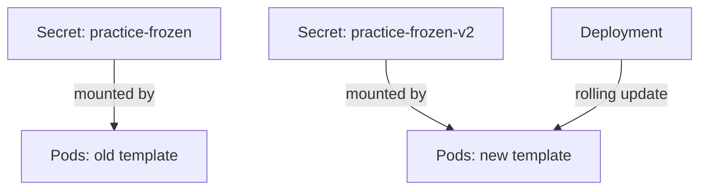

# Immutable Secrets

A Secret that changes while Pods use it causes two problems. A wrong edit reaches every Pod that mounts the Secret within about a minute, and an attacker who gains write access can change a credential without leaving a new object behind. Kubernetes can lock a Secret so that its data never changes. This part sets the field, shows what the API server refuses and explains how to replace a locked Secret.

## The immutable field

The field `immutable` sits at the top level of a Secret, next to `type`. When it is `true`, the API server rejects every update to `data` and `stringData`, and it rejects an update that sets `immutable` back to `false`. The only way to change the Secret is to delete it and create a new one. The data and the flag are frozen for good.

There is a second effect. The kubelet watches the Secrets that its Pods use, so it can refresh the mounted files. It does not need to watch an immutable Secret, because the value cannot change. A cluster with many immutable Secrets puts less load on the API server.

## Create and test an immutable Secret

Save this as `secret-practice-frozen.yaml`:

<!-- astrona:playground:renew -->

```yaml
apiVersion: v1
kind: Secret
metadata:
  name: practice-frozen
  namespace: starfleet
type: Opaque
immutable: true
stringData:
  token: disposable-frozen-v1
```

Apply it:

```sh
kubectl apply -f secret-practice-frozen.yaml
kubectl -n starfleet get secret practice-frozen -o jsonpath='{.immutable}{"\n"}'
```

The second command prints `true`. Now try to change the value. The command must fail, so the next two commands are separate steps:

```sh
kubectl -n starfleet patch secret practice-frozen --type merge -p '{"stringData":{"token":"changed"}}'
```

The API server answers with a `Forbidden` error that says the field is immutable. Nothing is stored. Try to unlock the Secret in the same way:

```sh
kubectl -n starfleet patch secret practice-frozen --type merge -p '{"immutable":false}'
```

This request fails with the same kind of error. The lock cannot be removed, which is the point: a user with update rights cannot quietly unlock the Secret and change it.

## Replace an immutable Secret

A credential must still be rotated. With an immutable Secret, you create a new object with a new name and point the consumers at it. Name the new Secret `practice-frozen-v2`, and change the Pod template of the workload to use that name. A Deployment sees a change in the Pod template and starts new Pods with a rolling update, so every consumer restarts and loads the new value. The old Secret can be deleted after the rollout finishes.



The diagram shows that the Deployment replaces the Pods and the new Pods use the new Secret, while the old Secret stays unchanged until you delete it.

This procedure gives you an extra benefit. The Pod template records which Secret version each Pod uses, and a rollback restores the previous template and the previous Secret name together. A mutable Secret has no such record.

Delete the exercise Secret when you finish:

```sh
kubectl -n starfleet delete secret practice-frozen
```

A Pod that starts while the Secret is missing stays in `ContainerCreating`, because the kubelet cannot build the volume. Create the replacement before you delete the original.

You now know how to freeze a Secret and how to rotate a frozen one. The remaining question is who may read the Secret at all, which the next part answers with RBAC.

## Common pitfalls

> [!WARNING]
> - **Setting `immutable: true` before the value is right.** You cannot fix a typo. Delete the Secret and create it again.
> - **Deleting the old Secret before the new one is in use.** New Pods stay in `ContainerCreating` while the Secret is missing.
> - **Reusing the same name for the new value in a Deployment.** The Pod template does not change, so no rollout starts. Use a new name.
> - **Expecting immutability to hide the value.** It prevents changes, not reads.
