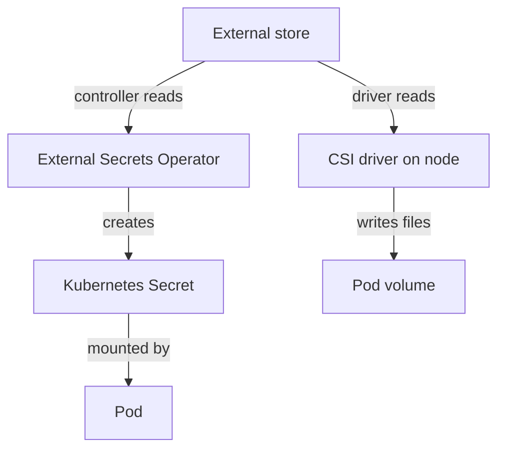

# External Secret Stores

A Kubernetes Secret keeps the credential in the cluster, in `etcd`, in backups and in the memory of every node that mounts it. An external secret store keeps the credential somewhere else: a managed service such as AWS Secrets Manager, Google Secret Manager or Azure Key Vault, or a self-hosted store such as HashiCorp Vault. The store has its own access policy, audit log, rotation and versioning. This part explains the two common ways to connect a cluster to a store and the trust that makes the connection work. It has no commands, because a store needs an account outside the playground.

## Why use an external store

A cluster Secret has three limits. Anyone who can read the Secret object or the `etcd` data reads the value. Rotation needs a manual update of every cluster. Access reviews need RBAC rules in every namespace. An external store moves these controls to one place. The value is created and rotated in the store, one policy says which workload may read it, and the store logs every read.

The cluster still needs the value at run time, so the question is how it gets there and where it is stored on the way. The two designs answer differently.

## Sync the value into a Secret

The External Secrets Operator is a controller that you install in the cluster. It adds custom resources. A `SecretStore` (or a `ClusterSecretStore` for all namespaces) describes the connection to the store and the authentication method. An `ExternalSecret` names the remote entry, the keys to copy and a `refreshInterval`. The controller reads the remote value and creates an ordinary Kubernetes Secret with the name you chose. It reads the store again at each interval, so a rotation in the store reaches the Secret without a manual update.

Pods then consume that Secret in the usual way, as a file or a variable. This design is simple for applications, because they need no change. The cost is that the value is again a Kubernetes Secret, so it is in `etcd`, subject to RBAC and subject to encryption at rest. The controller also holds the permission to write Secrets in the namespaces it serves.

## Mount the value without a Secret

The Secrets Store CSI driver takes the second path. The Container Storage Interface (CSI) is the Kubernetes interface that lets a driver provide volumes. A `SecretProviderClass` describes the store, the entries and the file names. A Pod mounts a CSI volume that refers to the class. When the kubelet starts the Pod, the driver on the node contacts the store with the identity of the Pod and writes the values into files in the volume. No Kubernetes Secret is needed.

The driver can optionally create a synced Secret too, through the field `secretObjects`, for applications that need an environment variable. That option returns to the first design for that value, so use it only when needed. The driver mounts at Pod start. A rotation reaches the file only if the driver is configured to rotate, and an application must read the file again.

The diagram shows two routes from the store to a Pod: through a Kubernetes Secret, or directly into a volume with no Secret object.

## How the cluster proves who it is

The store must decide whether to answer. The cluster identifies a workload with a ServiceAccount token, a signed JSON Web Token (JWT). The store checks the signature against the cluster's public keys, then reads the namespace and ServiceAccount name from the token and applies its policy. Cloud providers call this workload identity, and Vault calls it the Kubernetes authentication method. The result is that the cluster holds no long-lived store password.

If the connection uses a static access key stored in a Kubernetes Secret instead, the cluster has only moved the problem: that key reads every entry the store allows. Prefer short-lived tokens bound to a ServiceAccount, and give each ServiceAccount a store policy that names only its own entries.

You now know the two designs and the identity they rely on. A manifest in Git still needs some way to refer to a value, and the next part covers manifests that carry the encrypted value itself.

## Common pitfalls

> [!WARNING]
> - **Assuming an external store means no Secret in the cluster.** The synced design creates a normal Secret.
> - **Storing the store's access key in a Kubernetes Secret.** That key becomes the credential to protect.
> - **Using one broad store policy for every namespace.** Bind each ServiceAccount to its own entries.
> - **Expecting rotation to reach a running application.** The application must read the file or restart.
