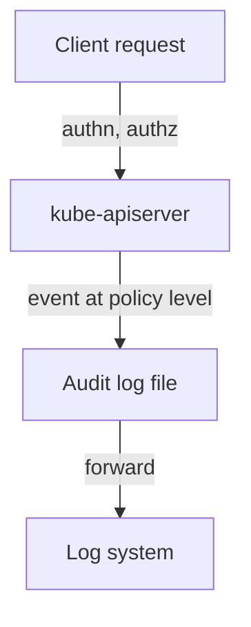

---
exam_objectives:
- Manage Kubernetes secrets
---
# Auditing Secret Access

Controls that prevent access are not enough. You also need a record of who read which Secret, so you can find a misuse and prove that a credential was or was not touched. The Kubernetes API server can write such a record, the audit log. The risk is the log itself: configured badly, it copies the Secret values into a file that many people can read. This part turns on the audit log in the playground, reads one Secret access from it, and shows how to review permissions with `kubectl`.

## The audit log and its levels

The audit log is a file of events written by the `kube-apiserver`. It is not an object that you apply with `kubectl`. An administrator starts the API server with the flag `--audit-policy-file`, which names a policy file, and the flag `--audit-log-path`, which names the output file. The policy has rules that match requests and give each match a level:

- `None`: write no event.
- `Metadata`: write who made the request, the verb, the resource, the name and the result. Write no request or response body.
- `Request`: write the metadata and the request body.
- `RequestResponse`: write the metadata, the request body and the response body.

A Secret request carries the value in its body. A `create` or `update` request body holds the new value, and a `get` response body holds the stored value. The levels `Request` and `RequestResponse` therefore write credentials into the audit log. The safe level for Secrets is `Metadata`.

Before you change anything, check that the API server in the playground writes no audit log yet. Open a shell on the VM with `astrona ssh astro-ats-034-playground-020-03`, then look for audit flags in the running process:

<!-- astrona:playground:renew -->

```sh
ps -ef | grep -o -- '--audit-[a-z-]*=[^ ]*'
```

The command prints nothing, so the API server records no access to any Secret.

## Write the policy

The API server checks the rules of a policy in order, and the first matching rule sets the level. The rule for Secrets therefore goes before any general rule. Save this as `policy-audit.yaml`:

```yaml
apiVersion: audit.k8s.io/v1
kind: Policy
omitStages:
- RequestReceived
rules:
- level: Metadata
  resources:
  - group: ""
    resources:
    - secrets
    - configmaps
- level: Metadata
```

The first rule records the metadata of requests for Secrets and ConfigMaps, without bodies. ConfigMaps are in the same rule because people often store credentials there. The last rule has no resource list, so it records the metadata of every other request. `omitStages` drops the `RequestReceived` stage. Each request then writes one event when the response is complete, instead of two.

The policy is a file on the control-plane node, not a Kubernetes object, so `kubectl apply` does not apply it. Copy it to the node path, readable only by root, and create the log directory:

```sh
sudo mkdir -p /etc/kubernetes/audit /var/log/kubernetes/audit
sudo cp policy-audit.yaml /etc/kubernetes/audit/policy.yaml
sudo chmod 600 /etc/kubernetes/audit/policy.yaml
sudo ls -l /etc/kubernetes/audit
```

The listing shows the file with mode `600`, owned by root:

```text
total 4
-rw------- 1 root root 187 Nov 18 11:54 policy.yaml
```

## Turn on the audit log in the static pod

The kubelet runs the kube-apiserver from the static pod manifest `/etc/kubernetes/manifests/kube-apiserver.yaml`. The kubelet watches that directory and starts every manifest in it, so a backup inside it would start a second API server. Keep the backup in `/root/backup`, then edit the manifest:

```sh
sudo mkdir -p /root/backup
sudo cp -p /etc/kubernetes/manifests/kube-apiserver.yaml /root/backup/kube-apiserver.yaml
sudo vi /etc/kubernetes/manifests/kube-apiserver.yaml
```

The API server runs in a container, so it reads a node file only through a volume. You add four flags, two volume mounts and two `hostPath` volumes. `--audit-log-maxage` and `--audit-log-maxbackup` make the API server delete old log files, so the log cannot fill the disk. The log directory is mounted without `readOnly`, because the API server writes to it. After the edit, `diff` against the backup shows every change:

```sh
sudo diff /root/backup/kube-apiserver.yaml /etc/kubernetes/manifests/kube-apiserver.yaml
```

```text
14a15,18
>     - --audit-policy-file=/etc/kubernetes/audit/policy.yaml
>     - --audit-log-path=/var/log/kubernetes/audit/audit.log
>     - --audit-log-maxage=7
>     - --audit-log-maxbackup=2
81a86,90
>     - mountPath: /etc/kubernetes/audit/policy.yaml
>       name: audit-policy
>       readOnly: true
>     - mountPath: /var/log/kubernetes/audit
>       name: audit-log
103a113,120
>   - hostPath:
>       path: /etc/kubernetes/audit/policy.yaml
>       type: File
>     name: audit-policy
>   - hostPath:
>       path: /var/log/kubernetes/audit
>       type: DirectoryOrCreate
>     name: audit-log
```

When you save the file, the kubelet stops the old API server container and starts a new one. In the test run, the API server answered again after about 40 seconds. Wait until it is ready, then check the flags and the new log file:

```sh
until kubectl get --raw=/readyz 2>/dev/null; do sleep 5; done; echo
ps -ef | grep -o -- '--audit-[a-z-]*=[^ ]*'
sudo ls -l /var/log/kubernetes/audit
```

```text
ok
--audit-policy-file=/etc/kubernetes/audit/policy.yaml
--audit-log-path=/var/log/kubernetes/audit/audit.log
--audit-log-maxage=7
--audit-log-maxbackup=2
total 192
-rw------- 1 root root 193154 Nov 18 11:55 audit.log
```

The API server runs with the four flags and already writes events. If it does not come back after two or three minutes, find its container with `sudo crictl ps -a --name kube-apiserver` and read its logs with `sudo crictl logs <container-id>`. A wrong path or a missing volume is the usual cause.

## Make an access to record

To see a useful event, give a ServiceAccount the right to read one Secret, then read it as that ServiceAccount. Save this as `role-auditor.yaml`:

```yaml
apiVersion: v1
kind: ServiceAccount
metadata:
  name: auditor
  namespace: starfleet
---
apiVersion: rbac.authorization.k8s.io/v1
kind: Role
metadata:
  name: practice-token-reader
  namespace: starfleet
rules:
- apiGroups:
  - ""
  resources:
  - secrets
  resourceNames:
  - practice-token
  verbs:
  - get
---
apiVersion: rbac.authorization.k8s.io/v1
kind: RoleBinding
metadata:
  name: auditor-practice-token-reader
  namespace: starfleet
roleRef:
  apiGroup: rbac.authorization.k8s.io
  kind: Role
  name: practice-token-reader
subjects:
- kind: ServiceAccount
  name: auditor
  namespace: starfleet
```

Apply it:

```sh
kubectl apply -f role-auditor.yaml
```

The `--as` flag sends a request as another identity. This is called impersonation: the API server checks the permissions of `auditor`, not your own. Read the allowed Secret, then try a `list` that the Role does not allow:

```sh
kubectl -n starfleet get secret practice-token --as=system:serviceaccount:starfleet:auditor
kubectl -n starfleet get secrets --as=system:serviceaccount:starfleet:auditor
```

```text
NAME             TYPE     DATA   AGE
practice-token   Opaque   1      42s
Error from server (Forbidden): secrets is forbidden: User "system:serviceaccount:starfleet:auditor" cannot list resource "secrets" in API group "" in the namespace "starfleet"
```

The API server allowed the `get` and denied the `list`. It wrote an audit event for each request.

## Read an event

Each event is one JSON line in the log. `jq`, a command-line tool for JSON, prints the newest `get` event for the Secret in a readable form:

```sh
sudo grep '"name":"practice-token"' /var/log/kubernetes/audit/audit.log | grep '"verb":"get"' | grep auditor | tail -1 | jq .
```

```json
{
  "kind": "Event",
  "apiVersion": "audit.k8s.io/v1",
  "level": "Metadata",
  "auditID": "f1464877-3440-414b-9081-37f1110d14a6",
  "stage": "ResponseComplete",
  "requestURI": "/api/v1/namespaces/starfleet/secrets/practice-token",
  "verb": "get",
  "user": {
    "username": "kubernetes-admin",
    "groups": [
      "kubeadm:cluster-admins",
      "system:authenticated"
    ],
    "extra": {
      "authentication.kubernetes.io/credential-id": [
        "X509SHA256=01acb9e35e070ceedf675993240891de7f3a914a8d1e2f356561983a37d1fd6f"
      ]
    }
  },
  "impersonatedUser": {
    "username": "system:serviceaccount:starfleet:auditor",
    "groups": [
      "system:serviceaccounts",
      "system:serviceaccounts:starfleet",
      "system:authenticated"
    ]
  },
  "sourceIPs": [
    "10.0.2.15"
  ],
  "userAgent": "kubectl/v1.35.10 (linux/arm64) kubernetes/ae6fece",
  "objectRef": {
    "resource": "secrets",
    "namespace": "starfleet",
    "name": "practice-token",
    "apiVersion": "v1"
  },
  "responseStatus": {
    "metadata": {},
    "code": 200
  },
  "requestReceivedTimestamp": "2026-11-18T11:55:32.104990Z",
  "stageTimestamp": "2026-11-18T11:55:32.105804Z",
  "annotations": {
    "authorization.k8s.io/decision": "allow",
    "authorization.k8s.io/reason": "RBAC: allowed by RoleBinding \"auditor-practice-token-reader/starfleet\" of Role \"practice-token-reader\" to ServiceAccount \"auditor/starfleet\""
  }
}
```

These fields answer the usual questions:

- `level`: the level the policy gave the request. Here it is `Metadata`.
- `user.username`: who sent the request. With impersonation, `impersonatedUser.username` names the identity that the API server checked. A ServiceAccount appears as `system:serviceaccount:<namespace>:<name>`.
- `verb`: the action, for example `get`, `list`, `watch`, `create`, `update` or `delete`.
- `objectRef.resource`, `objectRef.namespace` and `objectRef.name`: which object. A `list` has no name.
- `responseStatus.code`: the result. `200` succeeded and `403` was denied.
- `sourceIPs` and `userAgent`: where the request came from and which client sent it.
- `annotations`: the authorization decision and the RoleBinding that allowed it.

The event has no `requestObject` and no `responseObject`, so the value of the Secret is not in it. A short `jq` filter turns every Secret event of `auditor` into one line, which is easier to scan:

```sh
sudo grep '"resource":"secrets"' /var/log/kubernetes/audit/audit.log | jq -c 'select(.impersonatedUser.username // .user.username | test("auditor")) | {user: (.impersonatedUser.username // .user.username), verb, name: .objectRef.name, code: .responseStatus.code, level}'
```

```text
{"user":"system:serviceaccount:starfleet:auditor","verb":"get","name":"practice-token","code":200,"level":"Metadata"}
{"user":"system:serviceaccount:starfleet:auditor","verb":"list","name":null,"code":403,"level":"Metadata"}
```

The second line is the denied `list`. A `403` from a ServiceAccount shows an application that asks for more than its Role allows. That is a configuration error or an attacker probing. Finally, prove that no value reached the file. The disposable value of `practice-token` starts with `disposable`:

```sh
sudo grep -c disposable /var/log/kubernetes/audit/audit.log
```

The command prints `0`. Read the log for a pattern, not a single line. A ServiceAccount that runs `list` on Secrets in many namespaces deserves a look. So does a user that runs `get` on a Secret they never used before. The audit log is also protected data, because it names Secrets and users. Keep the file readable only by root, as above, and forward it to a log system that keeps a copy the cluster cannot erase.



The diagram shows that the API server writes the audit event for each request, at the level the policy gives it, and that the log is forwarded to a system outside the cluster.

## Review access with kubectl

An audit log shows what happened. A review shows what could happen. `kubectl auth can-i --list` prints every permission of an identity in a namespace:

```sh
kubectl -n starfleet auth can-i --list --as=system:serviceaccount:starfleet:auditor
```

The output is long, because every identity may call discovery endpoints such as `/api` and `/healthz`. The shortened output keeps the header and the line that matters:

```text
Resources                                       Non-Resource URLs                      Resource Names     Verbs
...
secrets                                         []                                     [practice-token]   [get]
```

The `secrets` line shows `get` on the one name `practice-token` and nothing else. The bindings show which subject uses which Role:

```sh
kubectl -n starfleet get rolebindings -o wide
```

```text
NAME                            ROLE                         AGE   USERS   GROUPS   SERVICEACCOUNTS
auditor-practice-token-reader   Role/practice-token-reader   3s                     starfleet/auditor
```

Run this review for every ServiceAccount that has a Pod, and also check ClusterRoleBindings with `kubectl get clusterrolebindings -o wide`. Remove any permission that the application does not use.

You now know how to record Secret access without recording values, how to read an event, and how to review permissions before an incident. Together with encryption at rest, narrow Roles and a store outside the cluster, this closes the paths that a Secret takes from creation to use. The open question is the retention and protection of the log itself, which the log system outside the cluster must handle.

## Common pitfalls

> [!WARNING]
> - **Auditing Secrets at `Request` or `RequestResponse` level.** The log then holds the values. Use `Metadata`.
> - **Putting the general rule first.** The first matching rule wins, so list the Secret rule first.
> - **Forgetting the volumes.** The API server runs in a container. Without the `hostPath` volumes, it cannot read the policy or write the log, and it does not start.
> - **Keeping the manifest backup in `/etc/kubernetes/manifests`.** The kubelet starts it as a second API server. Keep backups in another directory.
> - **Leaving the audit file readable by everyone.** It names users and Secrets.
> - **Reviewing only Roles.** Check bindings, ClusterRoles and who can create Pods.
