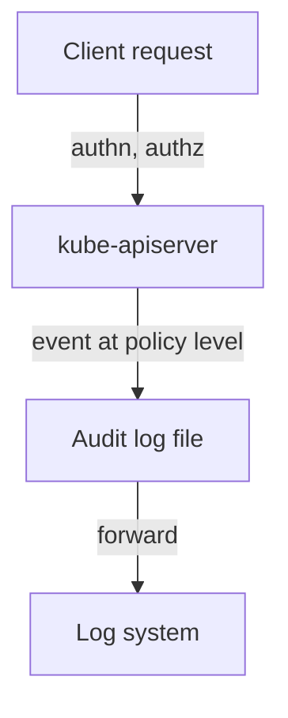

# Auditing Secret Access

Controls that prevent access are not enough. You also need a record of who read which Secret, so you can find a misuse and prove that a credential was or was not touched. The Kubernetes API server can write such a record, the audit log. The risk is the log itself: configured badly, it copies the Secret values into a file that many people can read. This part explains audit levels, a safe policy for Secrets, how to read an event, and how to review access with `kubectl`.

## The audit log and its levels

The audit log is a file of events written by the `kube-apiserver`. It is not an object that you apply with `kubectl`. An administrator starts the API server with the flags `--audit-policy-file`, which names a policy file, and `--audit-log-path`, which names the output file. The policy has rules that match requests and give each match a level:

- `None`: write no event.
- `Metadata`: write who made the request, the verb, the resource, the name and the result. Write no request or response body.
- `Request`: write the metadata and the request body.
- `RequestResponse`: write the metadata, the request body and the response body.

A Secret request carries the value in its body: a `create` or `update` request body holds the new value, and a `get` response body holds the stored value. The levels `Request` and `RequestResponse` therefore write credentials into the audit log. The safe level for Secrets is `Metadata`.

## A policy for Secrets

The first matching rule decides the level, so the rule for Secrets goes before any general rule. This is the content of a policy file on the control-plane node:

```yaml
apiVersion: audit.k8s.io/v1
kind: Policy
rules:
  - level: Metadata
    resources:
      - group: ""
        resources: ["secrets", "configmaps"]
  - level: Request
    resources:
      - group: ""
        resources: ["pods"]
  - level: Metadata
```

The first rule records the metadata of requests for Secrets and ConfigMaps, without bodies. The second records the body of Pod requests, which is useful when you review a Pod that mounts a Secret. The last rule, without a resource list, records the metadata for everything else. The ConfigMap is in the first rule because people often store credentials there. This file is a reference. You cannot apply it in the playground, because the playground control plane is not yours to reconfigure.

## Read an event

Each event is one JSON line in the log. These fields answer the usual questions:

- `user.username` and `user.groups`: who made the request. A ServiceAccount appears as `system:serviceaccount:<namespace>:<name>`.
- `verb`: the action, for example `get`, `list`, `watch`, `create`, `update` or `delete`.
- `objectRef.resource`, `objectRef.namespace` and `objectRef.name`: which object. A `list` has no name.
- `responseStatus.code`: the result. `200` succeeded and `403` was denied.
- `sourceIPs` and `userAgent`: where the request came from and which client sent it.

Read the log for a pattern, not a line. A ServiceAccount that does `list` on Secrets in many namespaces, or a user that does `get` on a Secret they never used before, deserves a look. A `403` from a ServiceAccount shows an application that asks for more than its Role allows, which is a configuration error or an attacker probing.

The audit log is also protected data. It names Secrets and users, so restrict who can read the file and forward it to a log system that keeps a copy the cluster cannot erase.

## Review access with kubectl

An audit log shows what happened. A review shows what could happen. Check what an identity can do in the playground, and list the bindings:

<!-- astrona:playground:renew -->

```sh
kubectl -n starfleet auth can-i --list --as=system:serviceaccount:starfleet:default
kubectl -n starfleet get rolebindings,roles -o wide
kubectl get clusterrolebindings -o wide
```

The first command lists the permissions of the `default` ServiceAccount in `starfleet`. Look for `secrets` in the resource column with the verbs `get`, `list` or `watch`. The other two commands list the bindings that grant permissions, so you can see which subjects use a Role that touches Secrets. Run the review for every ServiceAccount that has a Pod, and remove any permission that the application does not use.



The diagram shows that the API server writes the audit event for each request, at the level the policy gives it, and that the log is forwarded to a system outside the cluster.

You now know how to record access without recording values, and how to review permissions before an incident. Together with encryption at rest, narrow Roles and a store outside the cluster, this closes the paths that a Secret takes from creation to use.

## Common pitfalls

> [!WARNING]
> - **Auditing Secrets at `Request` or `RequestResponse` level.** The log then holds the values. Use `Metadata`.
> - **Putting the general rule first.** The first matching rule wins, so list the Secret rule first.
> - **Forgetting ConfigMaps.** Credentials end up there, so give them the same level.
> - **Leaving the audit file readable by everyone.** It names users and Secrets.
> - **Reviewing only Roles.** Check bindings, ClusterRoles and who can create Pods.
