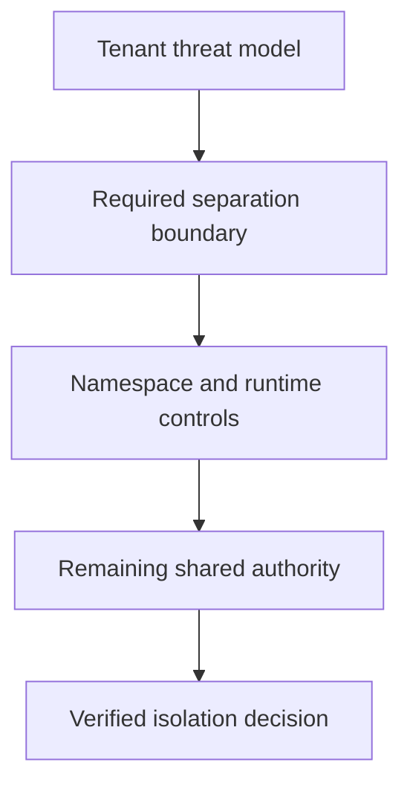

# Choosing Isolation For Untrusted Tenants

Two untrusted applications use different namespaces but share the same node kernel. Namespace organization alone does not supply a separate host trust boundary.

## Learning objectives

- Distinguish namespaced API separation from kernel isolation.
- Compare shared-kernel, sandboxed-runtime and dedicated-node boundaries.
- Explain RuntimeClass prerequisites and scheduling effects.

## Before you start

This chapter is standalone reading material; no running cluster or installed tools are required. A Pod is the Kubernetes unit for running one or more containers, and a namespace groups namespaced objects. Treat the worked configurations as teaching examples rather than recorded observations from a provisioned environment.

## Responsible components and behavior

Multi-tenancy places workloads belonging to different users or trust levels on shared infrastructure. A security design must state which tenant actions and compromises it is intended to contain. Namespaces, network policy, resource controls and sandboxed execution contribute different boundaries. They should not be treated as interchangeable versions of the same protection.

## Identify The Shared Boundary

A namespace scopes many Kubernetes objects and can have separate permissions, quotas and admission policy. It does not give its Pods an independent kernel. Ordinary containers on one node share the host kernel even when they have separate process, mount and network namespaces. Kernel isolation mechanisms reduce visibility and authority, but a kernel vulnerability can cross that shared trust boundary.

Tenant isolation also involves credentials and data. A workload allowed to use another tenant's ServiceAccount or volume can obtain authority through legitimate API operations without escaping its container. Review who may create workloads, select identities, request host access and mount sensitive storage. A boundary limited to object naming does not address those paths.

## Compare Execution Models

A sandboxed container runtime can place an additional boundary between application syscalls and the host. Different implementations may use an application kernel, virtualization or another mediation design. Their threat model, compatibility and overhead differ. The appropriate choice depends on the expected untrusted code and the host interfaces that need protection.

Dedicated nodes separate tenants from some shared-node risks, while dedicated clusters or infrastructure can separate additional control-plane and administrative boundaries. These options have operational costs and do not eliminate every shared cloud, network or identity dependency. State which resources remain shared after choosing stronger placement isolation.

## RuntimeClass Is A Selection Contract

Kubernetes RuntimeClass identifies a configured runtime handler and can describe scheduling and overhead relationships. It does not install the handler onto a node. A workload selecting a handler requires eligible nodes whose runtime implements that handler. The node runtime, RuntimeClass definition and workload selection must agree.

Scheduling constraints can help place sandboxed workloads where the runtime is available. Overhead accounting can reflect resources consumed by the runtime arrangement. A Pod that references a valid RuntimeClass may still fail to start if the chosen node lacks the handler or if the application requires unsupported behavior. Admission acceptance and runtime usability are distinct stages.

## Preserve Other Controls

A sandboxed process can still use credentials intentionally supplied to it. If its cloud token allows administrative operations, stronger syscall mediation does not remove that authority. Network policies should restrict unnecessary dependency access, resource quotas should constrain declared consumption, and storage access should fit tenant ownership.

Consider an untrusted job that parses uploaded files. A sandbox may reduce the impact of a parser exploit reaching the host kernel. However, the job also needs a narrow input and output path, bounded resources and no unnecessary metadata credentials. Allowing unrestricted access to an internal database would create a separate route to harm even if the sandbox works correctly.

## Evaluate Compatibility And Failure

The assessment should include normal startup, required filesystem operations, networking, observability and recovery behavior. When a sandbox blocks an unsupported operation, identify whether the application can use a safer supported path or needs a different isolation model. Broadly disabling the sandbox hides the trust decision rather than resolving it. Document residual shared dependencies and the owner of each boundary so tenant expectations match actual enforcement.

## Work through the decision

A namespace scopes objects and can support scoped policies. Containers commonly share the host kernel while receiving their supported process and filesystem isolation. A sandboxed runtime, dedicated node or separate cluster can offer additional boundaries under its implementation.

Choose isolation from the threat model: who controls code, which data needs separation and what a node compromise would expose. API grants, network policy, admission and runtime choice contribute different protection. Dedicated nodes still share some control-plane relationships; separate clusters still need protected credentials and external services. State which attacker capability the chosen boundary reduces and which authority remains shared.

Isolation strength follows the actual trust boundaries rather than the presence of a namespace label.

Isolation strength follows the actual trust boundaries rather than the presence of a namespace label.

## Common pitfalls

> [!WARNING]
> Namespaces are not independent kernels, and RuntimeClass does not install a runtime. Stronger execution isolation does not neutralize excessive credentials, shared data access or unbounded dependency use.
