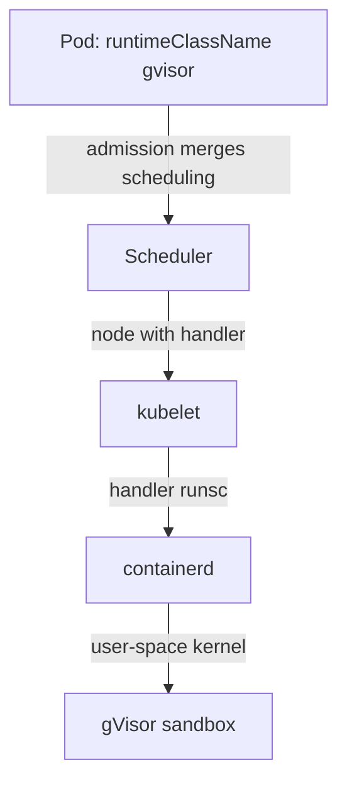

# Sandboxed Containers With RuntimeClass

Every layer so far works inside one Linux kernel. A container is a process, and all processes of a node share the node's kernel. If an attacker finds a bug in the kernel and runs code in a container, the attacker reaches the host and every other container on it. Policy objects cannot fix that, because the bug is below Kubernetes. Sandboxed runtimes add a second boundary between the container and the host kernel. This part explains what they are, how a Pod selects one, and how to check and troubleshoot it.

## Two kinds of sandbox

A **sandboxed container** is a container that runs on top of an extra isolation layer, so a kernel bug in the application's system calls does not reach the host kernel. Two projects are common:

- **gVisor** runs the container against a user-space kernel written in Go, called the Sentry. The Sentry handles the application's system calls and makes only a small, filtered set of calls to the host kernel. The runtime is `runsc` (run sandboxed container). Its cost is slower system calls and some unsupported calls.
- **Kata Containers** starts each Pod in a lightweight virtual machine with its own guest kernel. The container runs inside the guest, and a hypervisor separates it from the host. Its cost is start time and memory per Pod, and it needs virtualization support on the node.

Both integrate with the container runtime (containerd or CRI-O) as an additional runtime handler. The node administrator installs the handler and registers it in the runtime configuration under a name, such as `runsc` for gVisor. Without that work, Kubernetes has nothing to run.

## The RuntimeClass object

A **RuntimeClass** is a cluster-scoped object that maps a name to a runtime handler. A Pod selects it with `spec.runtimeClassName`. The kubelet then asks the container runtime to create the Pod sandbox with that handler. Save this as `runtimeclass-gvisor.yaml`:

<!-- astrona:playground:renew -->

```yaml
apiVersion: node.k8s.io/v1
kind: RuntimeClass
metadata:
  name: gvisor
handler: runsc
```

Apply it:

```sh
kubectl apply -f runtimeclass-gvisor.yaml
```

Then check the result:

```sh
kubectl get runtimeclass
```

The list shows `gvisor` with the handler `runsc`. The object only holds a name and a handler. It does not install anything. The playground nodes have no `runsc` handler, and the next step shows what that means for a Pod. Save this as `pod-sandboxed.yaml`:

```yaml
apiVersion: v1
kind: Pod
metadata:
  name: sandboxed
  namespace: default
spec:
  runtimeClassName: gvisor
  containers:
  - name: app
    image: docker.io/library/busybox:1.37.0
    command: ["sleep", "3600"]
```

Apply it and look at the Pod:

```sh
kubectl apply -f pod-sandboxed.yaml
kubectl get pod sandboxed
kubectl describe pod sandboxed
```

The API server accepts the Pod, because the RuntimeClass exists. The Pod is scheduled, and then it stays in `ContainerCreating`. The events at the end of the `describe` output show a failed sandbox creation, and the message names the runtime handler `runsc` as one that the runtime does not know. The kubelet cannot start the Pod without the handler. This is the troubleshooting path for sandbox problems on a real cluster too: an accepted Pod that never starts means the node lacks the handler.

Delete the Pod:

```sh
kubectl delete pod sandboxed
```

## Put sandboxed Pods on the right nodes

Not every node has the handler. A RuntimeClass can carry a `scheduling` block with a `nodeSelector` and `tolerations`. The API server merges them into every Pod that selects the class, so the scheduler places the Pod only on nodes that have the handler. A `RuntimeClass` can also carry an `overhead` block with `podFixed` resources, such as `memory: 120Mi`, for the cost of the sandbox. The scheduler adds that to the Pod's requests and the quota counts it.



The diagram shows that the RuntimeClass selects the handler by name, and that containerd, not Kubernetes, starts the sandbox.

## Verify a real sandbox

On a cluster that has gVisor installed, check from inside the Pod. The command `dmesg` in a gVisor sandbox prints the startup messages of the Sentry, not the host kernel's log, and `uname -r` reports a kernel version that does not match the node. On the node, `crictl pods` shows the Pod with its runtime handler. The Pod spec alone proves only that the Pod asked for the class.

A sandbox lowers the risk of a kernel escape. It does not replace the other layers. A sandboxed Pod still needs a restricted security context, a network policy and a minimal token. Some features, such as host networking, privileged mode and certain volume types, do not work or add risk in a sandbox. Pod Security Admission can also exempt a RuntimeClass by name in its admission configuration, so check that the exemption list is empty for tenant classes.

You can now pick the right isolation level for a tenant: namespaces and policy for trusted teams, sandboxed runtimes for untrusted code on shared nodes, and dedicated nodes or clusters when the risk is higher still.

## Common pitfalls

> [!WARNING]
> - **Creating a RuntimeClass and assuming the runtime exists.** The object names a handler. The node administrator must install and register it.
> - **Reading `runtimeClassName` as proof of a sandbox.** An accepted Pod only asked for it. Check the events and the node.
> - **Skipping `scheduling` on a mixed cluster.** The scheduler can place the Pod on a node without the handler, and the Pod never starts.
> - **Forgetting overhead.** A sandbox uses extra memory. Without `overhead`, quota and scheduling undercount.
> - **Treating a sandbox as a full tenant boundary.** Network, RBAC and quota are still needed.
