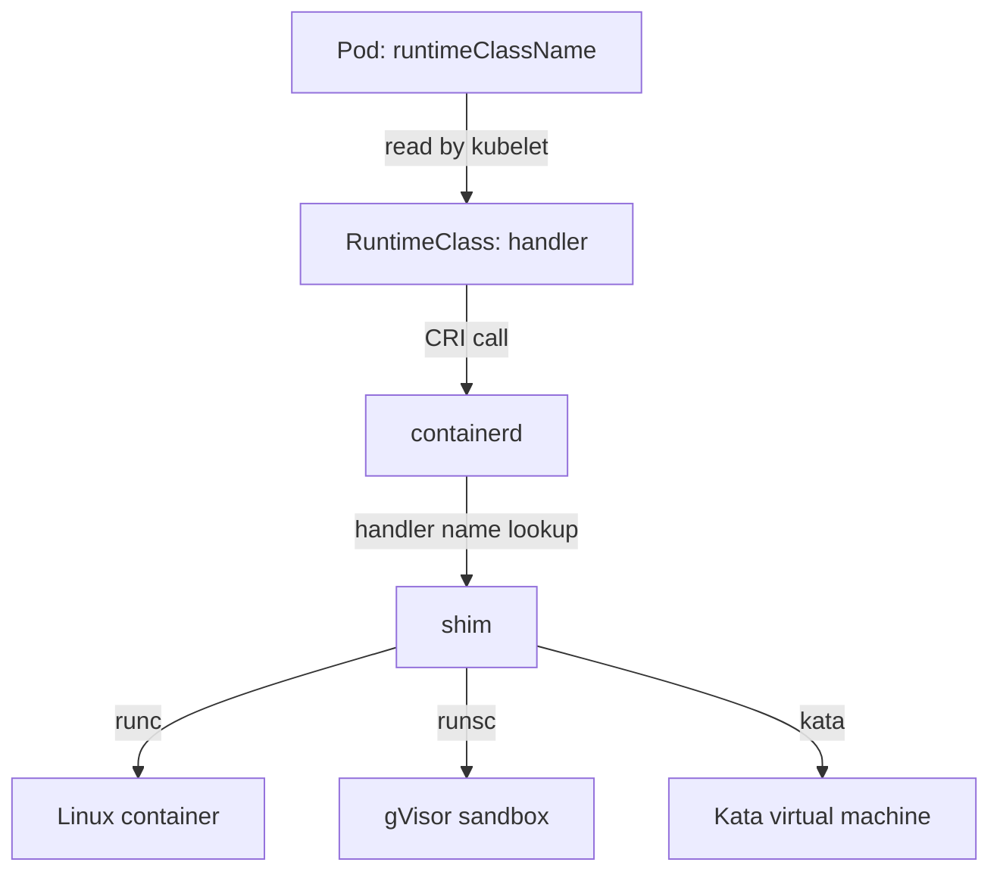

---
exam_objectives:
- Understand and implement isolation techniques (multi-tenancy, sandboxed containers, etc.)
---
# The Runtime Handler Chain

A Pod spec names a runtime class, but the kubelet does not start containers. Several components sit between the field and a running process, and each one can fail in its own way. When a sandboxed Pod hangs, the first skill is to know which link to inspect. This part follows the chain from the API object to the low-level runtime and shows where the handler names live on a node.

## From the Pod to the process

The **kubelet** is the agent on each node that starts the Pods assigned to that node. It does not create containers itself. It calls a container runtime through the **Container Runtime Interface (CRI)**, a gRPC API. In most clusters the runtime is **containerd**, and in others it is CRI-O.

When the kubelet starts a Pod, it first asks the runtime to create a **Pod sandbox**: the shared environment, such as the network namespace, that all containers of the Pod use. The request to create the sandbox carries a runtime handler name. For a Pod with `runtimeClassName: gvisor`, the kubelet looks up the `RuntimeClass` named `gvisor`, reads its `handler` field and sends that string.

containerd looks up the handler name in its own configuration. Each entry names a **shim**, a small process that containerd starts for each Pod and that runs the low-level runtime. The shim for the default handler starts `runc`, which creates ordinary Linux containers. The shim for gVisor starts `runsc`. The shim for Kata Containers starts a lightweight virtual machine.



The diagram shows that the Kubernetes object only supplies a string, and that containerd decides what the string means.

## Find the handlers on the node

The handler names live in the containerd configuration on the node, so you need a shell on the node. Open one on the playground VM (virtual machine) and check that kubectl uses the playground cluster:

<!-- astrona:playground:renew -->

```sh
astrona ssh astro-ats-034-playground-030-02
kubectl config current-context
kubectl get nodes -o wide
```

The context is `kubernetes-admin@astro-ats-034-playground-030-02`. The last column of the node list shows `containerd://2.2.1`, which tells you which runtime the kubelet calls. Now read the runtime tables in the containerd configuration file. The file belongs to root, so use `sudo`:

```sh
sudo grep -n "runtimes\.\|runtime_type" /etc/containerd/config.toml
```

```text
85:        [plugins.'io.containerd.cri.v1.runtime'.containerd.runtimes.runc]
86:          runtime_type = 'io.containerd.runc.v2'
100:          [plugins.'io.containerd.cri.v1.runtime'.containerd.runtimes.runc.options]
275:[plugins.'io.containerd.cri.v1.runtime'.containerd.runtimes.runsc]
276:  runtime_type = "io.containerd.runsc.v1"
```

Each table whose name ends in `runtimes.<name>` registers one handler, and `<name>` is the handler name. This node has `runc` and `runsc`. The `runtime_type` value selects the shim: `io.containerd.runc.v2` for runc and `io.containerd.runsc.v1` for gVisor. Kata Containers uses `io.containerd.kata.v2`. The table path `plugins.'io.containerd.cri.v1.runtime'` belongs to the configuration format `version = 3` of containerd 2.x. containerd 1.x uses the path `plugins."io.containerd.grpc.v1.cri"` instead.

The file shows what is saved, but containerd reads it only when it starts. To see the handlers that the running containerd has loaded, ask it through the CRI with `crictl`, the command-line client for the CRI:

```sh
sudo crictl info | jq -r '.config.containerd.runtimes | keys[]'
```

The output lists `runc` and `runsc`. If you add a table to the file, this list changes only after `sudo systemctl restart containerd`.

## Run a Pod with the gVisor handler

A `RuntimeClass` maps a name that Pods use to a handler name. It is a cluster-scoped object, so it has no namespace. Save this as `runtimeclass-gvisor.yaml`:

```yaml
apiVersion: node.k8s.io/v1
kind: RuntimeClass
metadata:
  name: gvisor
handler: runsc
```

Apply it:

```sh
kubectl apply -f runtimeclass-gvisor.yaml
```

Now a Pod can ask for the class. Save this as `pod-gvisor-check.yaml`:

```yaml
apiVersion: v1
kind: Pod
metadata:
  name: gvisor-check
  namespace: tenant-b
spec:
  runtimeClassName: gvisor
  containers:
  - name: app
    image: docker.io/library/busybox:1.37.0
    command: ["sleep", "3600"]
```

Apply it and wait for the Pod:

```sh
kubectl apply -f pod-gvisor-check.yaml
kubectl -n tenant-b wait --for=condition=Ready pod/gvisor-check --timeout=120s
```

The Pod spec only shows what the Pod asked for. To see what really ran, ask containerd which handler created the sandbox:

```sh
sudo crictl pods --namespace tenant-b --name gvisor-check
```

The `RUNTIME` column shows `runsc`. A Pod without a class shows `(default)` in that column, which means the `runc` handler. This column is the node-side proof that the handler name reached the runtime.

## What this means for troubleshooting

Each link of the chain fails in its own way, and the error comes from a different component. If the `RuntimeClass` object does not exist, the RuntimeClass admission plugin in the API server rejects the Pod at creation. You can see this with a class name that does not exist:

```sh
kubectl -n tenant-b run missing --image=docker.io/library/busybox:1.37.0 --restart=Never --overrides='{"spec":{"runtimeClassName":"does-not-exist"}}' -- sleep 60
```

```text
Error from server (Forbidden): pods "missing" is forbidden: pod rejected: RuntimeClass "does-not-exist" not found
```

If the object exists but containerd has no handler with that name, the API server accepts the Pod, because it does not know which handlers the nodes have. The scheduler places the Pod, and then the kubelet fails to create the sandbox. The Pod stays in `ContainerCreating`, and its events show `FailedCreatePodSandBox` with a message like this one, for a class whose handler is `gvisor` (the sandbox ID is shortened):

```text
Failed to create pod sandbox: rpc error: code = Unknown desc = unable to get OCI runtime for sandbox "cd030051...": no runtime for "gvisor" is configured
```

The kubelet reports the event, but the text after `desc =` comes from containerd. It names the handler that containerd could not find. The fix is on the node: add the table and restart containerd, or correct the `handler` field. After a restart with the handler in place, the kubelet retries the sandbox and the same Pod starts without any change.

You can now follow a Pod from its `runtimeClassName` to the shim, find the handlers on a node, and say which component fails in each case. Choosing a handler is a different question: what does each sandbox actually change about the isolation boundary, and what does it cost?

## Common pitfalls

> [!WARNING]
> - **Assuming Kubernetes starts the sandbox.** The kubelet only sends a handler name. containerd or CRI-O and its shim do the work.
> - **Confusing a missing class with a missing handler.** A missing `RuntimeClass` is rejected at creation. A missing handler leaves an accepted Pod in `ContainerCreating`.
> - **Editing the containerd file without a restart.** containerd keeps the handlers it loaded at start. Check `crictl info` after the restart.
> - **Judging the runtime from the Pod spec.** The spec shows the request. Check the `RUNTIME` column of `crictl pods` to see what ran.
> - **Matching handler names loosely.** The `handler` string must equal the table name in the runtime configuration exactly.
