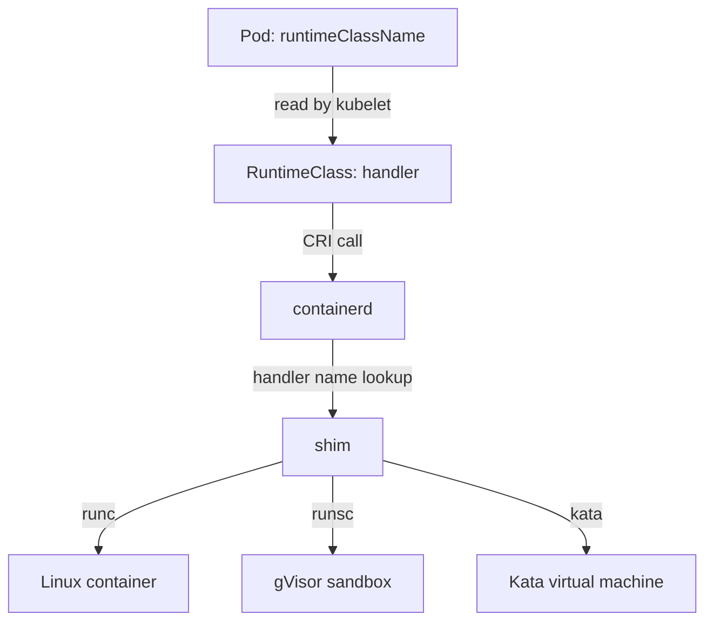

# The Runtime Handler Chain

A Pod spec names a runtime class, but the kubelet does not start containers. Several components sit between the field and a running process, and each one can fail in its own way. When a sandboxed Pod hangs, the first skill is to know which link to inspect. This part follows the chain from the API object to the low-level runtime and shows where the handler names live on a node.

## From the Pod to the process

The **kubelet** is the agent on each node that starts the Pods assigned to that node. It does not create containers itself. It calls a container runtime through the **Container Runtime Interface (CRI)**, a gRPC API. In most clusters the runtime is **containerd**, and in others it is CRI-O.

When the kubelet starts a Pod, it first asks the runtime to create a **Pod sandbox**: the shared environment, such as the network namespace, that all containers of the Pod use. The request to create the sandbox carries a runtime handler name. For a Pod with `runtimeClassName: gvisor`, the kubelet looks up the `RuntimeClass` named `gvisor`, reads its `handler` field and sends that string.

containerd looks up the handler name in its own configuration. Each entry names a **shim**, a small process that containerd starts for each Pod and that runs the low-level runtime. The shim for the default handler starts `runc`, which creates ordinary Linux containers. The shim for gVisor starts `runsc`. The shim for Kata Containers starts a lightweight virtual machine.



The diagram shows that the Kubernetes object only supplies a string, and that containerd decides what the string means.

## Show the default handler

Look at the nodes first. The wide listing includes the container runtime of each node:

<!-- astrona:playground:renew -->

```sh
kubectl get nodes -o wide
```

The last column shows `containerd` and its version for both nodes. Now read the handler table on the worker node. The playground nodes are containers, and the commands below run inside the worker container of this playground only:

```sh
worker_name="astro-ats-034-playground-030-02-worker"
podman exec "$worker_name" grep -n "runtimes" /etc/containerd/config.toml
```

The lines name the registered handlers. The exact table path depends on the containerd version, and the playground node lists `runc`. A real sandbox node lists one more table for each extra handler. The `runtime_type` value inside that table selects the shim. For gVisor it is `io.containerd.runsc.v1`, and for Kata Containers it is `io.containerd.kata.v2`.

## A class for the existing handler

A `RuntimeClass` can point at a handler that already exists. Save this as `runtimeclass-runc-explicit.yaml`:

```yaml
apiVersion: node.k8s.io/v1
kind: RuntimeClass
metadata:
  name: runc-explicit
handler: runc
```

Apply it:

```sh
kubectl apply -f runtimeclass-runc-explicit.yaml
```

Save this Pod as `pod-runc-explicit.yaml`. It uses the class in `tenant-b`:

```yaml
apiVersion: v1
kind: Pod
metadata:
  name: explicit-runtime
  namespace: tenant-b
spec:
  runtimeClassName: runc-explicit
  containers:
  - name: app
    image: docker.io/library/busybox:1.37.0
    command: ["sleep", "3600"]
```

Apply it and wait for the Pod:

```sh
kubectl apply -f pod-runc-explicit.yaml
kubectl -n tenant-b wait --for=condition=Ready pod/explicit-runtime --timeout=120s
```

The Pod starts, because containerd knows the handler `runc`. Ask the runtime what it created. The `crictl` tool talks to the CRI of the node:

```sh
podman exec "$worker_name" crictl pods --name explicit-runtime
```

Recent `crictl` versions print a runtime column in this listing. The column shows the handler that created the sandbox. It is the node-side evidence that the field reached the runtime, and the Pod spec alone cannot give it.

## What this means for troubleshooting

The two failures look different. If the `RuntimeClass` object does not exist, the API server rejects the Pod at creation, because the RuntimeClass admission plugin checks the name. If the object exists but containerd has no matching handler, the API server accepts the Pod and the kubelet fails to create the sandbox. The Pod then stays in `ContainerCreating`, and the events name the missing handler.

You can now follow a Pod from its `runtimeClassName` to the shim and say which component fails in each case. Choosing a handler is a different question: what does each sandbox actually change about the isolation boundary, and what does it cost? The next part answers that.

## Common pitfalls

> [!WARNING]
> - **Assuming Kubernetes starts the sandbox.** The kubelet only sends a handler name. containerd or CRI-O and its shim do the work.
> - **Confusing a missing class with a missing handler.** A missing `RuntimeClass` is rejected at creation. A missing handler leaves an accepted Pod in `ContainerCreating`.
> - **Judging the runtime from the Pod spec.** The spec shows the request. Check the sandbox on the node to see what ran.
> - **Matching handler names loosely.** The `handler` string must equal the name in the runtime configuration exactly.
