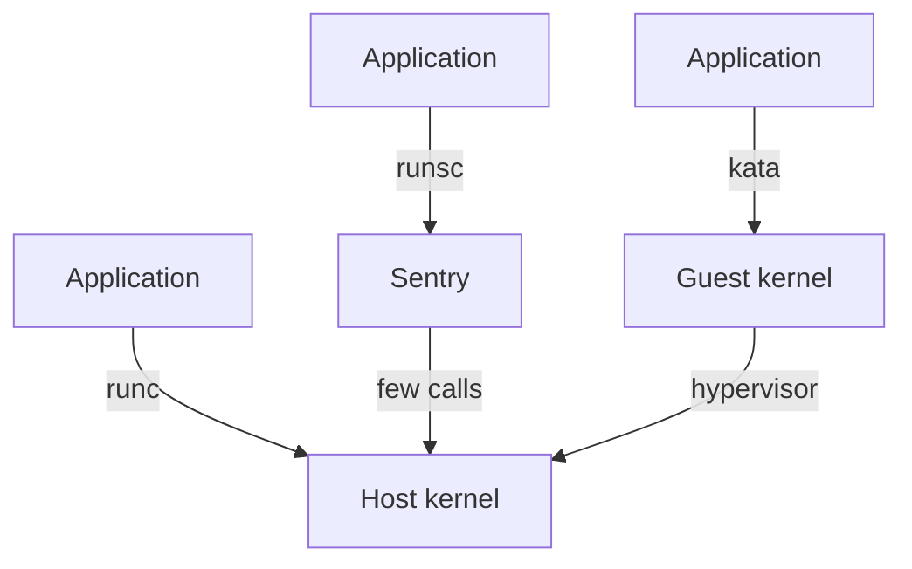

---
exam_objectives:
- Understand and implement isolation techniques (multi-tenancy, sandboxed containers, etc.)
---
# gVisor And Kata Compared

Both common sandboxes promise a stronger boundary than an ordinary container, but they build that boundary in different places. The choice changes performance, compatibility and node requirements. This part explains where each boundary sits, what each one costs, and how to decide, so that a `RuntimeClass` is chosen for a reason and not by habit.

## The boundary of an ordinary container

An ordinary container is a Linux process with restrictions: namespaces limit what it can see, control groups limit what it can use, and a seccomp filter limits which system calls it can make. Every allowed system call still runs in the host kernel. A bug in any allowed call gives the container code the privileges of the kernel. The sandboxes below put another layer between the application and the host kernel.

## gVisor: a kernel written in user space

**gVisor** intercepts the system calls of the application. Its component called the **Sentry** is a kernel written in Go that runs as an ordinary process. The Sentry implements the Linux system call interface itself, including the file system and the network stack. It makes only a small set of calls to the host kernel. A bug in the application's system calls reaches the Sentry, not the host kernel.

The runtime binary is `runsc`. It does not need hardware virtualization, so it runs on most cloud virtual machines. Its costs are slower system calls, slower file and network input and output, and some system calls and `/proc` entries that it does not implement. An application that needs an unsupported feature fails or behaves differently.

## Kata Containers: a virtual machine for each Pod

**Kata Containers** starts every Pod in a lightweight virtual machine with its own guest kernel. A hypervisor, such as QEMU or Cloud Hypervisor, separates the guest from the host. The containers of the Pod run inside the guest, so a kernel bug in the application's calls stays in the guest kernel.

The boundary is hardware-enforced virtualization, which gives strong separation and good compatibility, because the guest runs a real Linux kernel. The costs are a longer start time, extra memory for the guest kernel and the agent, and the need for virtualization support on the node. Many cloud instance types do not expose it without nested virtualization.



The diagram shows that the three runtimes differ in what stands between the application and the host kernel: nothing, a user-space kernel, or a guest kernel.

## Compare runc and gVisor on the playground

The playground node has the `runc` and `runsc` handlers, so you can put the two boundaries side by side. Run the commands in a shell on the playground VM (virtual machine), which you open with `astrona ssh astro-ats-034-playground-030-02`. The sandboxed Pod needs a RuntimeClass that maps the name `gvisor` to the handler `runsc`. Save this as `runtimeclass-gvisor.yaml`:

<!-- astrona:playground:renew -->

```yaml
apiVersion: node.k8s.io/v1
kind: RuntimeClass
metadata:
  name: gvisor
handler: runsc
```

Apply it. If the class already exists, kubectl reports `unchanged`:

```sh
kubectl apply -f runtimeclass-gvisor.yaml
```

Next, create two Pods that differ only in `runtimeClassName`. Save this as `pods-kernel-check.yaml`:

```yaml
apiVersion: v1
kind: Pod
metadata:
  name: kernel-check
  namespace: tenant-b
spec:
  containers:
  - name: app
    image: docker.io/library/busybox:1.37.0
    command: ["sleep", "3600"]
---
apiVersion: v1
kind: Pod
metadata:
  name: kernel-check-gvisor
  namespace: tenant-b
spec:
  runtimeClassName: gvisor
  containers:
  - name: app
    image: docker.io/library/busybox:1.37.0
    command: ["sleep", "3600"]
```

Apply it and wait for both Pods:

```sh
kubectl apply -f pods-kernel-check.yaml
kubectl -n tenant-b wait --for=condition=Ready pod/kernel-check pod/kernel-check-gvisor --timeout=120s
```

Now print the kernel release that each container sees, and the release of the node:

```sh
kubectl -n tenant-b exec kernel-check -- uname -r
kubectl -n tenant-b exec kernel-check-gvisor -- uname -r
uname -r
```

```text
6.8.0-149-generic
4.19.0-gvisor
6.8.0-149-generic
```

The `runc` container reports the node kernel, because its system calls go straight to that kernel. The gVisor container reports `4.19.0-gvisor`, the version that the Sentry presents. The Sentry answers the system call itself, so the container never talks to the node kernel directly. In a Kata Pod, the same command reports the version of the guest kernel.

The kernel log shows the same boundary. Read it in both Pods:

```sh
kubectl -n tenant-b exec kernel-check-gvisor -- dmesg
kubectl -n tenant-b exec kernel-check -- dmesg
```

The gVisor Pod prints its own short log that starts with `Starting gVisor...` and ends with `Ready!`. The `runc` Pod fails with `dmesg: klogctl: Operation not permitted`. The node kernel blocks the request, because the container shares that kernel and may not read its log. Both results show which kernel answers the container.

Isolation has a cost in memory. On the node, each gVisor Pod has three extra processes: the shim `containerd-shim-runsc-v1`, the Sentry process `runsc-sandbox` and the file proxy `runsc-gofer`. List their memory use (the resident set size, in KB):

```sh
ps -eo rss,args | grep -E 'runsc-sandbox|runsc-gofer|containerd-shim-runsc' | grep -v grep | awk '{print $1, $2}'
```

On a test run, one idle busybox Pod used about 17 MB for the shim, 11 MB for the gofer and 31 MB for the Sentry, so about 60 MB in total. Your numbers differ, and they grow with the workload. This memory belongs to no container, so the scheduler does not see it unless the RuntimeClass declares it as overhead.

## Choosing between them

Use gVisor when nodes are virtual machines without nested virtualization, and the workload uses common system calls. Use Kata Containers when the application needs full Linux compatibility, or when the strongest separation is required and the nodes support virtualization. Test the real application on the sandbox before the decision. A passing test proves compatibility. It does not prove that the application is free of bugs.

Neither sandbox protects against every attack. A stolen ServiceAccount token, an open network path and an unlimited resource request work the same in a sandbox. Sandboxes also do not change who can create Pods: a user who may create Pods can leave out the class.

You can now compare the two boundaries and their costs. A sandbox needs nodes that have it, and it needs extra memory. The next part shows how a `RuntimeClass` places Pods on the right nodes and accounts for that cost.

## Common pitfalls

> [!WARNING]
> - **Calling a sandbox a replacement for the other layers.** Network policy, token control and quota still apply.
> - **Choosing gVisor without testing the application.** An unimplemented system call fails at run time, not at admission.
> - **Choosing Kata on nodes without virtualization.** The Pod cannot start where the hypervisor cannot run.
> - **Reading equal `uname -r` values as a sandbox.** Equal values on a node mean the container shares the host kernel.
