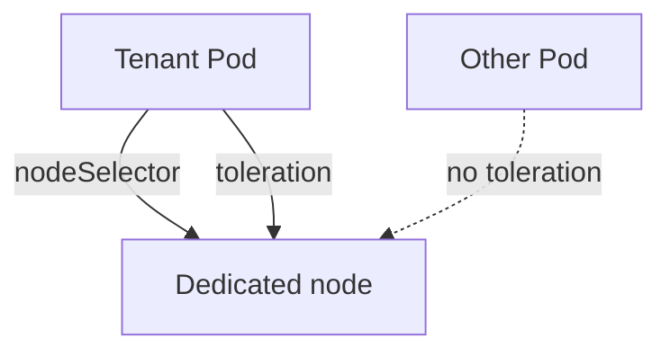

# Dedicated Nodes With Taints And Tolerations

Two tenants on one node share its kernel, its disk and its memory. An attacker who escapes one container reaches the Pods of the other tenant. The strongest simple control inside one cluster is to give a tenant its own nodes. This part shows how three scheduling features work together to do that, and why each one alone is not enough.

## Three features, three jobs

A **label** is a key and value on a node. A **node selector** in a Pod spec attracts the Pod to nodes with a matching label. A **taint** is a key, value and effect on a node that repels Pods. A **toleration** in a Pod spec allows the Pod onto nodes with a matching taint. The scheduler, which assigns Pods to nodes, evaluates all of them.

The jobs are separate. A taint keeps other tenants off the node. A toleration lets the owning tenant onto it, but it does not send the Pod there. The node selector sends the tenant's Pods to the node. Dedicating a node needs the taint and the label on the node, and the selector and the toleration on the Pod.

The taint effects differ. `NoSchedule` stops new Pods without a toleration and leaves running Pods alone. `PreferNoSchedule` is a soft preference that the scheduler may ignore. `NoExecute` also evicts running Pods that lack the toleration.



The diagram shows that the selector and the toleration both come from the tenant Pod, and that a Pod without the toleration cannot land on the node.

## Dedicate the worker node

Label the worker node for the tenant `tenant-c`:

<!-- astrona:playground:renew -->

```sh
kubectl label node astro-ats-034-playground-030-03-worker tenant=tenant-c
```

Add the taint with the effect `NoSchedule`:

```sh
kubectl taint node astro-ats-034-playground-030-03-worker tenant=tenant-c:NoSchedule
```

Save this Deployment as `deployment-tenant-c-app.yaml`:

```yaml
apiVersion: apps/v1
kind: Deployment
metadata:
  name: tenant-c-app
  namespace: tenant-c
spec:
  replicas: 1
  selector:
    matchLabels:
      app: tenant-c-app
  template:
    metadata:
      labels:
        app: tenant-c-app
    spec:
      nodeSelector:
        tenant: tenant-c
      tolerations:
      - key: tenant
        operator: Equal
        value: tenant-c
        effect: NoSchedule
      containers:
      - name: app
        image: docker.io/library/busybox:1.37.0
        command: ["sleep", "3600"]
```

Apply it and wait for the rollout:

```sh
kubectl apply -f deployment-tenant-c-app.yaml
kubectl -n tenant-c rollout status deployment/tenant-c-app --timeout=120s
```

Check where the Pod runs:

```sh
kubectl -n tenant-c get pods -o wide
```

The node column shows the labeled worker. Now test the other side. Save a Pod without the toleration as `pod-stray.yaml`:

```yaml
apiVersion: v1
kind: Pod
metadata:
  name: stray
  namespace: tenant-c
spec:
  containers:
  - name: app
    image: docker.io/library/busybox:1.37.0
    command: ["sleep", "3600"]
```

Apply it and describe it:

```sh
kubectl apply -f pod-stray.yaml
kubectl -n tenant-c describe pod stray
```

The Pod stays `Pending`. The scheduler event reports that the control-plane node has a taint the Pod does not tolerate and that the worker has the taint `tenant=tenant-c`. The scheduler, not the kubelet, refused the placement.

## Failure cases

If you forget the node selector, the tenant Pod can run on any untainted node, including shared ones. If you forget the taint, other tenants can land on the dedicated node. A toleration with `operator: Exists` and no key tolerates every taint, so a tenant that sets it can run on any tainted node. The node itself therefore does not enforce the separation. The scheduler enforces it from fields that the tenant writes in the Pod, which the next two parts address.

You can now dedicate a node and prove both the allowed and the blocked placement. The weak point is who may set and change these labels and tolerations.

## Common pitfalls

> [!WARNING]
> - **Using a toleration alone.** It permits the node and does not choose it.
> - **Using a taint without a selector.** The tenant Pods may run on shared nodes.
> - **Expecting `NoSchedule` to move running Pods.** Only `NoExecute` evicts.
> - **Tolerating with an empty key and `Exists`.** That tolerates every taint.
> - **Forgetting the taint on the control plane.** Ordinary Pods are kept off it only by its existing taint.
