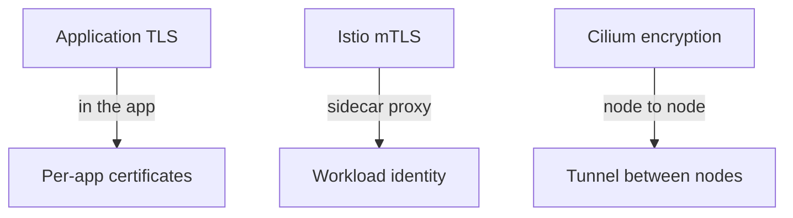

# Pod Traffic And Encryption Options

A Service call between two Pods crosses the network. On the same node it crosses a virtual network device. Between nodes it crosses the physical or virtual network of the cluster. Kubernetes does not encrypt either path. This part shows what an observer sees by default, looks at what the Istio sidecar changes in the playground, and compares the three ways to add encryption.

## What the default network exposes

The network plugin (the CNI plugin, Container Network Interface) gives each Pod an IP address and moves packets between Pods. It does not encrypt them. A request from the `shuttle` Pod to the `probe` Service is an HTTP request in plain text inside an IP packet. Three kinds of observer can read it:

- A process with network capture rights on the node, for example in a privileged Pod on the same node.
- A device on the path between nodes, such as a switch or a virtual network appliance.
- Anyone with access to a packet capture or a mirror port of the cluster network.

Encryption makes the content unreadable to them. **mTLS** (mutual Transport Layer Security) goes further. Both sides of a connection present a certificate, so each side also knows who the other one is. Plain TLS authenticates only the server.

## What the playground sends today

Check that the application Pods in `starfleet` run a sidecar. A **sidecar proxy** is an extra container in the Pod, here Envoy, that intercepts the Pod's incoming and outgoing traffic.

<!-- astrona:playground:renew -->

```sh
kubectl -n starfleet get pods -l app=probe -o jsonpath='{.items[0].spec.containers[*].name}'
kubectl get namespace starfleet --show-labels
kubectl -n istio-system get pods
```

The first command lists two container names: the application container `probe` and `istio-proxy`. The second shows the label `istio-injection=enabled`, which makes the Istio injection webhook add the proxy to each new Pod in that namespace. The third shows that `istiod` runs. `istiod` issues a certificate to each sidecar and sends it the configuration.

Now call the `probe` Service from two clients. The `shuttle` Pod has a sidecar. The `drifter` Pod in `outpost` does not:

```sh
kubectl -n starfleet exec shuttle -c client -- wget -q -T 3 -O- http://probe.starfleet.svc.cluster.local/
kubectl -n outpost exec drifter -- wget -q -T 3 -O- http://probe.starfleet.svc.cluster.local/
```

Both commands return one line of text that starts with `version=v1`. The first request went through two sidecars. The client's sidecar sent it with mTLS, because Istio's automatic mTLS uses TLS whenever the destination also has a sidecar. The second request reached the destination sidecar as plain text, and the sidecar accepted it. The sidecar of `probe` accepts both kinds of traffic, because no policy says otherwise. That behavior is called permissive mode, and it is the default.

The result shows the first problem a cluster operator meets. Encryption exists, but it is optional, so one client without a sidecar still sends plain text, and the server still accepts it.

## Three ways to encrypt



The diagram names the three approaches and where each one works: in the application, in a sidecar next to it, or between the nodes.

- **Application TLS.** Each application uses TLS libraries and manages its own certificates. It protects exactly the connections you configure, and it needs code and certificate work in every service.
- **Service mesh mTLS (Istio).** A sidecar proxy in each Pod encrypts and authenticates the connection, and the application sees plain HTTP on localhost. It gives each workload an identity based on its ServiceAccount. It works at the level of TCP connections between meshed Pods and supports authorization by identity.
- **Transparent encryption (Cilium).** The network plugin encrypts the packets between nodes with WireGuard or IPsec. Applications and Pods do not change. It covers all protocols, but only for traffic between nodes, and it gives the traffic no per-workload identity.

The choice depends on what must be protected and what must be known about the caller. Mesh mTLS answers "who is calling and is the connection private". Cilium encryption answers "is traffic between nodes private". The next part applies the first answer to the playground.

## Common pitfalls

> [!WARNING]
> - **Assuming sidecar injection means encrypted traffic.** In permissive mode, the destination still accepts plain text from clients without a sidecar.
> - **Assuming a Pod without a sidecar cannot send traffic.** It can, and the traffic is plain text.
> - **Confusing TLS with mTLS.** TLS authenticates the server. mTLS authenticates both sides.
> - **Expecting node-level encryption to give identity.** A tunnel between nodes protects packets, and it does not tell the receiver which workload sent them.
