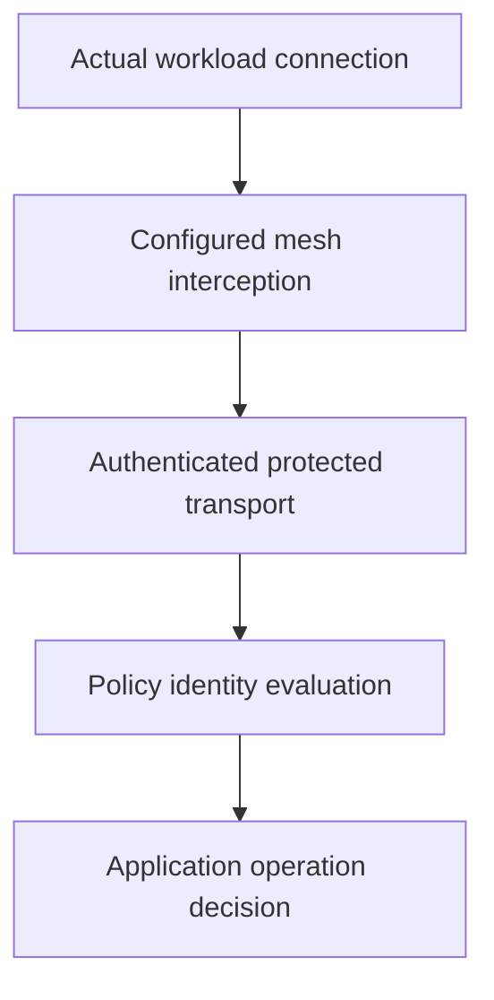

# Transport Protection And Mesh Limits

A proxy encrypts a connection to another workload, but that workload still permits an unauthorized application operation. Transport authentication and application authorization answer different questions.

## Learning objectives

- Distinguish encrypted transport, peer authentication and authorization.
- Explain where mesh components implement communication policy.
- Relate certificate rotation and hop boundaries to trust.

## Before you start

This chapter is standalone reading material; no running cluster or installed tools are required. A Pod is the Kubernetes unit for running one or more containers, and a namespace groups namespaced objects. Treat the worked configurations as teaching examples rather than recorded observations from a provisioned environment.

## Responsible components and behavior

Two applications need encrypted communication and consistent request telemetry. A service mesh adds infrastructure for communication between services, commonly through proxies or node-level components controlled by a mesh control plane. Depending on the implementation, it can provide identity, encryption, request routing, retries and observability.

A mesh and a network policy solve related but distinct problems. A policy can limit which network connections are allowed. A mesh can apply application-level behavior and authenticated service identities. Their combination can provide several layers of control, but installing either does not automatically configure every protection an application needs.

Transport Layer Security (TLS) protects a connection against network observation and tampering when correctly configured. The client verifies the server's certificate identity and trust chain. Encryption without correct identity verification can still connect securely to the wrong party. Mutual TLS adds certificate authentication of the client as well as the server.

Authentication identifies a peer; authorization decides what that peer may do. Mutual TLS can establish that a request came from `shuttle`, but a separate policy may still be needed to decide whether `shuttle` may call a particular operation. Encrypted traffic is not proof of permitted application behavior.

Retries also need care. Repeating a read may be safe; repeating a payment request without an idempotency mechanism can duplicate an effect. Timeouts and retry budgets prevent failed dependencies from consuming all available resources. A mesh cannot infer the safety of every application operation.

Choose the control from the requirement: connection isolation, verified transport identity, encrypted bytes or application permission. Explaining each separately avoids treating “secure networking” as one setting that guarantees all four.

## Separating Peer Identity From User Permission

Mutual TLS can establish that a connection comes from the `shuttle` service identity and reaches the intended `probe` service identity. Certificate trust, identity mapping and rotation support that result. It does not automatically establish which human user initiated the work or whether that user may perform the requested operation.

An application can require both service identity and an end-user credential. The service mesh may enforce some policy, while application code enforces data-specific permissions. State which layer evaluates which identity. A valid service certificate is not a substitute for checking access to a particular customer's record.

Transport encryption protects data on the configured connection path. If TLS terminates at a proxy and the next hop is plaintext, the encrypted boundary ends there unless another protected connection is established. Claims of end-to-end protection should identify each hop and where plaintext exists rather than infer safety from one external secure endpoint.

## Retry And Timeout Tradeoffs

Suppose `shuttle` retries a report creation request after a timeout. The server may have completed the write before the response was lost. Retrying can create another report unless the operation uses a stable request identity or other deduplication. Transport failure and transaction failure are not equivalent observations.

Timeouts bound how long callers wait, while retry counts and backoff bound repeated attempts. Retries can improve response to a transient failure but increase load on an overloaded dependency. A circuit breaker can limit repeated attempts when failure persists. These controls need to fit the application's semantics and capacity.

A mesh supplies configurable mechanisms, not universal policy correctness. The useful design explains the authenticated peer, permitted operation, encrypted hops and safe failure behavior. NetworkPolicy can then narrow connection paths while higher layers enforce the remaining requirements.

## Work through the decision

A service mesh can provide identity-aware transport and policy through its installed implementation. Mutual Transport Layer Security (mTLS) authenticates peers and protects a connection using the configured trust system. The identity authenticated there may describe a workload rather than the end user who requested a report.

Review the actual traffic path, including connections that bypass a proxy or reach an external destination. Enabling mesh transport does not automatically protect every hop or remove vulnerable application logic. Authorization needs a rule matched to the relevant operation and identity. Verification should test required peer identity, permitted operations and rejected ones separately.

Transport protection establishes peer and connection properties without replacing application permission checks.

Transport protection establishes peer and connection properties without replacing application permission checks.

## Common pitfalls

> [!WARNING]
> Encryption, authentication and authorization are separate properties. A service mesh does not automatically make application retries safe or replace NetworkPolicy.
