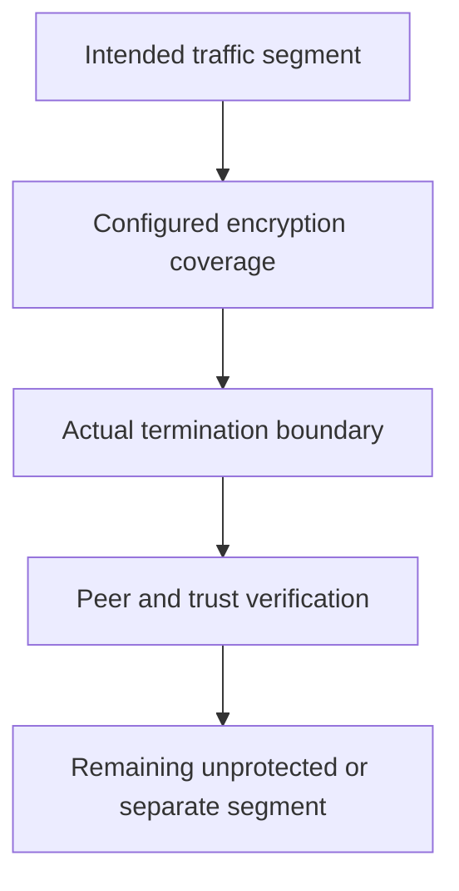

# Transparent Encryption And Its Traffic Boundaries

Cross-node Pod traffic is encrypted, while another path remains local or passes through an external frontend. One encryption feature does not establish protection for every connection segment.

## Learning objectives

- Distinguish encrypted transport, peer authentication and authorization.
- Explain where mesh components implement communication policy.
- Relate certificate rotation and hop boundaries to trust.

## Before you start

This chapter is standalone reading material; no running cluster or installed tools are required. A Pod is the Kubernetes unit for running one or more containers, and a namespace groups namespaced objects. Treat the worked configurations as teaching examples rather than recorded observations from a provisioned environment.

## Responsible components and behavior

Transparent encryption protects traffic without requiring each application to implement the network encryption mechanism itself. Cilium supports mechanisms such as IPsec and WireGuard under documented deployment requirements. The important question is which traffic segment is protected and under what identity and key model, not merely whether encryption is enabled somewhere.

## Identify The Mechanism And Segment

IPsec and WireGuard provide different encryption and key-management arrangements. Their supported configuration, kernel prerequisites and coverage differ. Review the selected mechanism and deployed version before making claims about workload, host or cross-cluster traffic. Same-node and cross-node paths can also have different treatment.

A packet may travel from a container through local host networking, across a node-to-node network and then into another workload. Protecting the inter-node segment does not automatically encrypt every local processing point or external connection. State where encryption begins and ends and which documented exclusions apply.

## Do Not Substitute Identity Claims

Transparent encryption can establish protected communication between network participants under its mechanism. Application TLS can protect a different segment and validate an application-facing certificate identity. Mutual TLS can add an application or workload authentication model. These are related security tools but not universally identical assurances.

Cilium's mutual authentication feature has its own support level, configuration and trust dependencies. It must not be described as an automatic consequence of enabling WireGuard or IPsec. Network encryption alone does not authorize an HTTP operation or remove the need for application credentials and business permission checks.

## Key Lifecycle Is Operational State

Encryption depends on the expected peers and usable key material. Rotation, distribution and trust changes need a supported lifecycle. A stale or incompatible peer state can interrupt communication even when ordinary routing is correct. Protect key material and restrict who may change the encryption configuration.

The appropriate evidence includes the active mechanism and its state, the selected traffic path and observations supported by the implementation. A configuration field stored in a values file is intent; it does not prove every node loaded it or that a particular connection uses the protected path.

## Account For Overhead And Reachability

Encryption adds packet overhead and can change the effective MTU. A path that worked without encryption can expose packet-size problems after protection is added. Peer communication also needs the relevant protocol and infrastructure access. Firewalls that permit application traffic but block the encryption transport can prevent the expected path.

Do not weaken policy or disable certificate verification to compensate for a misunderstood encryption dependency. Identify the failed relationship and preserve the intended confidentiality boundary. Some observability records can indicate encryption context, but their scope must match the actual path and collection support.

## Evaluate External And Local Dependencies

An encrypted Pod-to-Pod path does not automatically protect traffic to an external database or user client. Those connections can need application TLS or another supported mechanism. Likewise, an encrypted tunnel does not prevent a compromised permitted workload from reading data after decryption or using its legitimate credentials maliciously.

Map the sensitive data path and all termination points. Combine transport protection with least privilege, network authorization and protected endpoints. This produces a precise security claim and a useful troubleshooting model rather than an unqualified statement that every packet or application is secure.

## Work through the decision

Transparent network encryption protects the traffic covered by the network implementation's configured paths. Application Transport Layer Security (TLS) protects connections under the application's or proxy's certificate contract. These mechanisms can overlap while naming different peers and termination points.

Map the caller-to-frontend and frontend-to-backend segments separately. A frontend that terminates TLS may send plain traffic onward unless backend protection is configured. A node-network feature may protect cross-node transport without implementing application-user authorization. Verify the selected implementation's coverage and state excluded paths instead of treating an enabled option as universal end-to-end encryption.

Encryption claims need a named traffic segment, trust model and termination boundary.

Encryption claims need a named traffic segment, trust model and termination boundary.

## Common pitfalls

> [!WARNING]
> Encryption coverage is path-dependent. Transparent node traffic protection is not universally application mutual TLS, and configured intent must be distinguished from active keys and observed protected communication.
