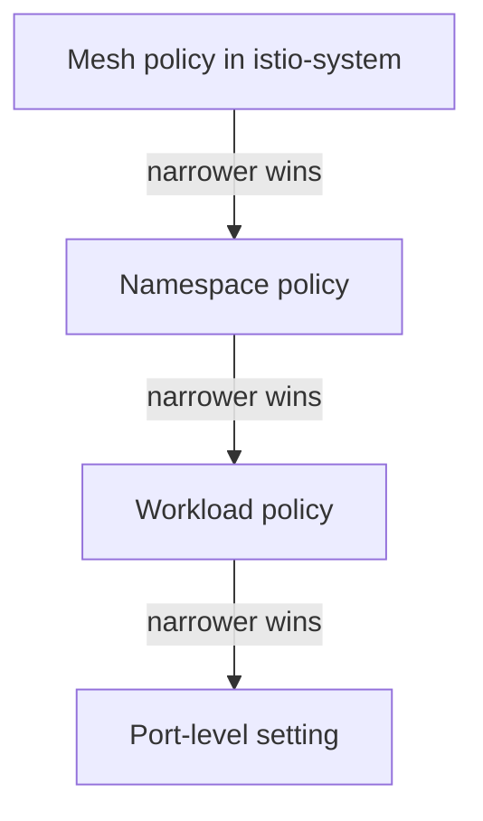

# Modes, Scope And Precedence

A cluster usually has more than one `PeerAuthentication`. One may cover the whole mesh, another one namespace, and a third one a single workload with an old client. If you cannot predict which one applies to a Pod, you cannot say whether its traffic is encrypted. This part gives the rules for the mode, the scope and the precedence, and then shows precedence working in the playground.

## The mode decides what the receiving sidecar accepts

A `PeerAuthentication` is a Kubernetes custom resource that tells a sidecar which incoming connections to accept. The field `spec.mtls.mode` has four values. `PERMISSIVE` accepts both mTLS and plain text, and it is the default when no policy exists. `STRICT` accepts only mTLS and closes every plain-text connection. `DISABLE` accepts only plain text. `UNSET` takes the mode from the next wider scope.

The object works on the receiving side only. It does not tell a client sidecar what to send. A client sidecar sends mTLS by itself when the destination has a sidecar. Istio calls this automatic mTLS, and it is on by default. The only things that change the client side are a `DestinationRule` with an explicit `trafficPolicy.tls` setting and the absence of a client sidecar.

## The scope comes from the namespace and the selector

Where you create the object and whether it has a `selector` decide which Pods it covers:

| Where | Selector | Scope |
| --- | --- | --- |
| `istio-system`, the root namespace | none | Every workload in the mesh |
| An application namespace | none | Every workload in that namespace |
| An application namespace | `matchLabels` | Pods with those labels |
| An application namespace | `matchLabels` and `portLevelMtls` | One or more ports of those Pods |

Port-level settings are only valid together with a selector. The port number is the port the workload listens on, which is the container port, not the port of the Service. A mistake here is common: a rule for Service port 80 does nothing when the application listens on 8080.

## The narrowest policy wins

When several policies match one Pod, Istio uses the most specific one. A port-level setting beats a workload policy, a workload policy beats a namespace policy, and a namespace policy beats the mesh policy. Policies do not merge. A narrower policy replaces the wider one for the Pods it selects, and `UNSET` is the way to say "use the wider one". If two policies have the same scope, the oldest one wins, so avoid creating two policies for one scope.

This rule makes exceptions safe. You can set `STRICT` for the whole mesh and give one workload `PERMISSIVE`, and the exception does not leak to other workloads.



The diagram shows the order in which a more specific policy replaces a wider one.

## Watch precedence in the playground

Confirm that no policy exists yet. The mesh then runs in `PERMISSIVE` mode:

<!-- astrona:playground:renew -->

```sh
kubectl get peerauthentication -A
kubectl -n outpost exec drifter -- wget -q -T 3 -O- http://probe.starfleet.svc.cluster.local/
```

The first command lists no objects. The second returns the line that starts with `version=v1`, because the sidecar of `probe` accepts the plain-text request from `drifter`. Save this as `peerauthentication-mesh-strict.yaml`:

```yaml
apiVersion: security.istio.io/v1
kind: PeerAuthentication
metadata:
  name: default
  namespace: istio-system
spec:
  mtls:
    mode: STRICT
```

Apply it and send the same request:

```sh
kubectl apply -f peerauthentication-mesh-strict.yaml
kubectl -n outpost exec drifter -- wget -q -T 3 -O- http://probe.starfleet.svc.cluster.local/
```

The request now fails with a connection error, because the namespace `starfleet` inherits the mesh policy. Now create a policy for the namespace that overrides it. Save this as `peerauthentication-namespace-permissive.yaml`:

```yaml
apiVersion: security.istio.io/v1
kind: PeerAuthentication
metadata:
  name: namespace-permissive
  namespace: starfleet
spec:
  mtls:
    mode: PERMISSIVE
```

Apply it and repeat the request:

```sh
kubectl apply -f peerauthentication-namespace-permissive.yaml
kubectl -n outpost exec drifter -- wget -q -T 3 -O- http://probe.starfleet.svc.cluster.local/
```

The request works again. The namespace policy is narrower than the mesh policy, so it wins for every Pod in `starfleet`. Remove both objects so that the next part starts from the default state:

```sh
kubectl delete -f peerauthentication-namespace-permissive.yaml -f peerauthentication-mesh-strict.yaml
```

You now know how a mode, a scope and the precedence rule combine into one effective setting. The open question is how to reach `STRICT` for a namespace that still has clients and workloads that cannot use mTLS, and the next part answers it.

## Common pitfalls

> [!WARNING]
> - **Creating the mesh policy in the wrong namespace.** Only an object in the root namespace `istio-system` without a selector covers the whole mesh.
> - **Using the Service port in `portLevelMtls`.** The port is the one the workload listens on.
> - **Expecting policies to merge.** A narrower policy replaces the wider one for the Pods it selects.
> - **Creating two policies for one scope.** The oldest policy wins, so the newer one has no effect.
> - **Thinking `PeerAuthentication` changes the client.** It only changes what the receiving sidecar accepts.
