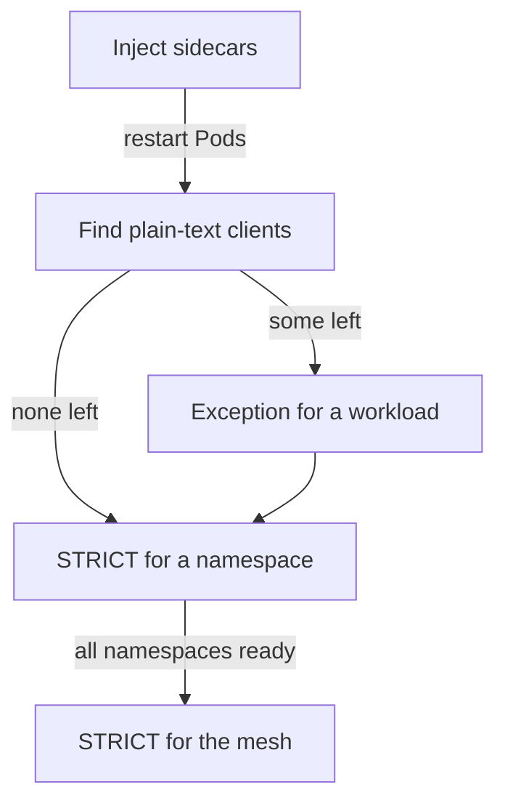

# Migrating From Permissive To Strict

Setting `STRICT` on a namespace is quick, and it breaks every client that cannot speak mTLS. In a running cluster some clients cannot: a Job in a namespace without injection, a monitoring agent, or an old service that nobody can change this quarter. This part gives a migration order that avoids an outage and shows how to keep one legacy workload reachable with a narrow exception.

## The migration order

Run these steps in order and do not skip the checks between them.

1. **Inject sidecars everywhere that talks to the namespace.** Label each namespace with `istio-injection=enabled`, then restart the Pods, because injection happens only when a Pod is created.
2. **Find the plain-text clients.** In `PERMISSIVE` mode the sidecars accept both kinds of traffic, so nothing fails yet. The metric `istio_requests_total` has the label `connection_security_policy`. The value `mutual_tls` means the request used mTLS. The value `none` means plain text, and each such series names a client that must get a sidecar or an exception.
3. **Enforce `STRICT` for one namespace.** Start with a namespace whose clients you know.
4. **Add exceptions only where needed.** A workload policy with `PERMISSIVE`, or a `portLevelMtls` entry for one port, keeps a legacy path open without weakening the rest.
5. **Widen the scope.** Put a `STRICT` policy in `istio-system` when every namespace is ready, and keep the exceptions.



The diagram shows that a plain-text client either gets a sidecar or an exception before the policy turns strict.

## Check the sidecars before you enforce

Start with the current state. The playground has a `legacy` workload next to `probe`. List the container names of every Pod in `starfleet`:

<!-- astrona:playground:renew -->

```sh
kubectl -n starfleet get pods -o jsonpath='{range .items[*]}{.metadata.name}{"\t"}{.spec.containers[*].name}{"\n"}{end}'
kubectl -n starfleet get pods -o wide
```

Every Pod shows an `istio-proxy` container next to its application container, which proves that injection worked. The client `drifter` in `outpost` has no sidecar, and it stands for the old client that cannot use mTLS. Check that it reaches both workloads before you change anything:

```sh
kubectl -n outpost exec drifter -- wget -q -T 3 -O- http://probe.starfleet.svc.cluster.local/
kubectl -n outpost exec drifter -- wget -q -T 3 -O- http://legacy.starfleet.svc.cluster.local/
```

Both commands return a line. The first starts with `version=v1` and the second with `version=legacy`.

## Enforce the namespace and keep one exception

Save this as `peerauthentication-namespace-strict.yaml`:

```yaml
apiVersion: security.istio.io/v1
kind: PeerAuthentication
metadata:
  name: namespace-strict
  namespace: starfleet
spec:
  mtls:
    mode: STRICT
```

Apply it and repeat both requests:

```sh
kubectl apply -f peerauthentication-namespace-strict.yaml
kubectl -n outpost exec drifter -- wget -q -T 3 -O- http://probe.starfleet.svc.cluster.local/
kubectl -n outpost exec drifter -- wget -q -T 3 -O- http://legacy.starfleet.svc.cluster.local/
```

Both requests fail now. The sidecars of `probe` and `legacy` received a plain-text connection and closed it. The old client still needs `legacy`, so give that workload its own policy. Save this as `peerauthentication-legacy-permissive.yaml`:

```yaml
apiVersion: security.istio.io/v1
kind: PeerAuthentication
metadata:
  name: legacy-permissive
  namespace: starfleet
spec:
  selector:
    matchLabels:
      app: legacy
  mtls:
    mode: PERMISSIVE
```

Apply it and test all three paths:

```sh
kubectl apply -f peerauthentication-legacy-permissive.yaml
kubectl -n outpost exec drifter -- wget -q -T 3 -O- http://legacy.starfleet.svc.cluster.local/
kubectl -n outpost exec drifter -- wget -q -T 3 -O- http://probe.starfleet.svc.cluster.local/
kubectl -n starfleet exec shuttle -c client -- wget -q -T 3 -O- http://probe.starfleet.svc.cluster.local/
```

The first command works because the workload policy for `app: legacy` replaces the namespace policy for those Pods. The second still fails, so `probe` stays protected. The third works because `shuttle` has a sidecar and sends mTLS. The exception is narrow: one label, one workload. If the old client could be changed to use the sidecar, you would delete this object and the workload would fall back to the namespace `STRICT`.

You now have a namespace that enforces mTLS except for one named workload. A policy that enforces mTLS depends on certificates, and the next part explains where they come from.

## Common pitfalls

> [!WARNING]
> - **Enforcing before injection.** Pods that start before the namespace label have no sidecar until they restart.
> - **Leaving the exception in place for ever.** A `PERMISSIVE` workload accepts plain text from anyone. Review exceptions and remove them when the client is fixed.
> - **Using a selector label the Pods do not have.** The policy then selects nothing and the namespace policy still applies. Compare the label with `kubectl get pods --show-labels`.
> - **Judging success by the policy only.** Test one allowed and one denied request.
> - **Forgetting clients outside the cluster.** Ingress gateways, monitoring and Jobs also send traffic, and under `STRICT` they need a sidecar or an exception.
