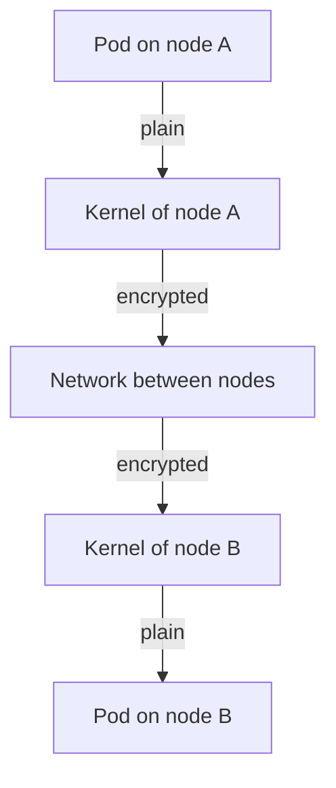

# What Cilium Encrypts

Before you enable encryption, you must know exactly which packets it covers. An administrator who assumes "all Pod traffic is encrypted" and is wrong has a false sense of security that is worse than no encryption at all. This part defines the scope of Cilium transparent encryption, compares the two protocols it offers and checks the first requirement, the kernel, on the nodes of the playground.

## Where the encryption happens

Cilium runs an agent on every node. The agent loads eBPF programs into the kernel and configures the network for the Pods on that node. With encryption enabled, a packet from a Pod on node A to a Pod on node B is encrypted by the kernel of node A just before it leaves the node, and decrypted by the kernel of node B when it arrives. The Pods and the applications use plain TCP and UDP and do not take part. This is why it is called transparent encryption.

The path between the two kernels is protected, and nothing else is. The result:

- Traffic between Pods on different nodes is encrypted.
- Traffic between two Pods on the same node never leaves the node, so Cilium does not encrypt it.
- Traffic from a Pod to a destination outside the cluster is not covered.
- Traffic that uses host networking is node traffic. WireGuard covers it only when node encryption is enabled.

Encryption does not authenticate the sending workload. A receiving Pod cannot tell which Pod sent a packet from the encryption alone. That job stays with a network policy or with a service mesh.

## WireGuard and IPsec

Cilium offers two protocols. They protect the same packets and differ in how they are built and managed.

| Question | WireGuard | IPsec |
| --- | --- | --- |
| Keys | Each node creates its own key pair, and Cilium shares the public keys between nodes | You create the keys in a Kubernetes Secret and rotate them yourself |
| Kernel | Needs WireGuard in the kernel, which is in Linux 5.6 and newer | Needs the kernel IPsec stack, which most kernels include |
| Network ports | UDP port 51871 between nodes | ESP packets (IP protocol 50) between nodes |
| Interface | The interface `cilium_wg0` on each node | No extra interface |
| Setup effort | Low | Medium, because of the key Secret |

Choose WireGuard when the kernels support it, because Cilium manages the keys and the setup is shorter. Choose IPsec when the kernel is too old for WireGuard or when a rule requires IPsec algorithms. Every node must support the protocol you choose.



The diagram shows that only the segment between the two kernels is encrypted.

## Check the starting point

The first requirement for WireGuard is the kernel version of every node. Kubernetes reports it for each node:

<!-- astrona:playground:renew -->

```sh
kubectl get nodes -o wide
```

The column `KERNEL-VERSION` shows the version. A node with a version below 5.6 needs the WireGuard kernel module from the distribution, or the cluster must use IPsec. In the playground the nodes are containers that share the kernel of the machine that runs them, so the value is the kernel of the host. Now look at the Helm values the playground stores for the cluster:

```sh
kubectl -n kube-system get configmap cilium-values -o jsonpath='{.data.values\.json}'
```

The result shows that `encryption.enabled` is `false`. Helm is the package manager that installs Cilium, and a values file is the configuration you pass to it. No encryption is active, and the next part changes the values.

You now know which segment is protected, what stays in plain text and how the two protocols differ. The next question is how to turn on WireGuard.

## Common pitfalls

> [!WARNING]
> - **Assuming same-node traffic is encrypted.** Packets between two Pods on one node stay inside the node.
> - **Assuming external traffic is encrypted.** Traffic to destinations outside the cluster is not covered.
> - **Expecting workload identity.** Encryption protects the path and does not tell the receiver which Pod sent the packet.
> - **Choosing WireGuard without checking all kernels.** One old node is enough to leave part of the cluster without encryption or to stop the agent.
> - **Mixing protocols.** A cluster uses either WireGuard or IPsec, not both.
